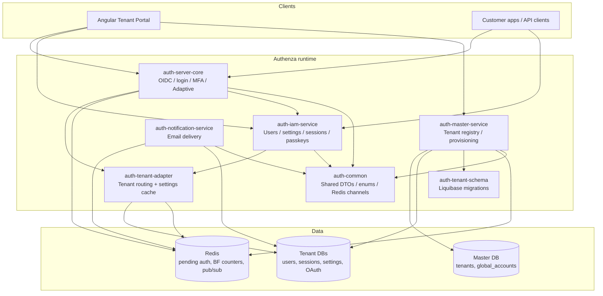

# Authenza — System Architecture

| Field | Value |
|-------|--------|
| Status | Living document |
| Scope | Backend multi-module auth platform + Tenant Portal integration points |
| Tracking | [`planning/ROADMAP.md`](../planning/ROADMAP.md) |
| Related | [`docs/PRD.md`](PRD.md), [`docs/prd/`](prd/README.md), [`README.md`](../README.md), [`Current Architecture walkthrough.md`](../Current%20Architecture%20walkthrough.md) |

This document describes **how Authenza is built today**, which capabilities are **completed**, and how the major pieces fit together. It is the architecture companion to the roadmap (status/ordering) and design docs (feature-level plans).

---

## 1. Product overview

Authenza is a **multi-tenant Identity and Access Management (IAM)** platform built on **Spring Authorization Server (OAuth2 / OIDC)**.

**Design pillars**

1. **Physical DB-per-tenant isolation** — each tenant gets its own database; auth and IAM traffic is routed by `tenantId`.
2. **Authenza as the OIDC provider** — tenant applications (including the Angular Tenant Portal) authenticate via standard OAuth2 Authorization Code + PKCE.
3. **Security controls at login** — password policy, brute-force lockout, MFA (TOTP), WebAuthn/passkeys, session tracking, and Adaptive / Risk-Based Auth (Phase A).
4. **Control plane vs data plane** — master service provisions tenants; auth-server + IAM serve day-to-day login and user management inside each tenant DB.

---

## 2. High-level architecture



### Typical local ports

| Service | Role | Typical port |
|---------|------|--------------|
| `auth-server-core` | Login UI + OAuth2/OIDC | `8081` |
| `auth-iam-service` | Tenant IAM APIs | `8082` |
| `auth-master-service` | Tenant admin / provisioning | `8083` |
| `auth-notification-service` | Email worker | (internal / subscribed to Redis) |
| MySQL | Master + tenant DBs | `3306` |
| Redis | Shared cache / pub-sub | `6379` |
| Tenant Portal | Angular SPA | `4200` |

Exact ports are configured in each service’s `application.yaml` / environment.

---

## 3. Gradle modules (responsibility map)

| Module | Responsibility |
|--------|----------------|
| **`auth-common`** | Shared contracts: Redis channel names, notification types, adaptive setting keys, DTOs/events (`SecurityAlertEvent`, etc.). |
| **`auth-tenant-schema`** | Liquibase changelogs for **tenant** DBs (and master where applicable). Keeps every new tenant structurally aligned (users, sessions, WebAuthn, adaptive settings, …). |
| **`auth-tenant-adapter`** | Multi-tenant plumbing: `TenantContextHolder`, routing `DataSource`, `TenantSettingsCache` (Caffeine + Redis invalidation), security filters that establish tenant context from the URI / headers. |
| **`auth-server-core`** | Spring Authorization Server + custom login journey: password, MFA pending state, force-password-change, Adaptive risk gate, session recording on login, Thymeleaf login/MFA pages, OIDC token issuance. |
| **`auth-iam-service`** | Tenant-scoped REST APIs: user CRUD/invite, MFA enroll/disable/reset, settings, sessions, passkeys, trusted devices, adaptive-auth settings. |
| **`auth-master-service`** | Control plane: register tenants (hosted or BYOD), run Liquibase against the new DB, seed owner as `TENANT_ADMIN`, publish `TenantProvisionedEvent`, manage global accounts / memberships. |
| **`auth-notification-service`** | Consumes Redis notification channels and sends branded emails (verification, password reset, invite, security alert). |
| **`auth-e2e-tests`** | End-to-end test harness (where maintained). |

**Shared library rule:** business logic that must run at **login time** lives in `auth-server-core` (or adapter). Admin/portal CRUD lives in `auth-iam-service` / `auth-master-service`. Events cross process boundaries via **Redis pub/sub**, not tight HTTP coupling where avoidable.

---

## 4. Multi-tenancy model

### 4.1 Isolation strategy

- **One physical database (or schema) per tenant.**
- Request path includes `/{tenantId}/...` (auth-server) or `X-TENANT-ID` (IAM/portal).
- `TenantContextHolder` + routing `DataSource` select the correct JDBC pool for that request.
- OAuth2 authorizations, users, sessions, MFA secrets, and settings **never** mix across tenants.

### 4.2 Master vs tenant data

| Store | Examples |
|-------|----------|
| **Master DB** | Tenant registry, JDBC URLs, global accounts, memberships, provisioning metadata |
| **Tenant DB** | `application_user`, roles/authorities, `tenant_settings`, `user_session`, `webauthn_credential`, `user_trusted_device`, OAuth2 tables |

### 4.3 Provisioning (completed)

1. Portal / API calls master: create tenant (hosted MySQL or BYOD JDBC).
2. Master inserts registry row, runs Liquibase (`auth-tenant-schema`) on the new DB.
3. Owner shadow user is created with `TENANT_ADMIN`.
4. Redis publishes provisioned event so runtime nodes can register the new DataSource.
5. User lands on `/{tenantId}/dashboard` (portal post-login resolver).

---

## 5. Authentication & authorization architecture

### 5.1 Login gate order (auth-server-core)

After valid credentials, the success path applies gates in this order:

```text
Password / Passkey OK
    → Force password change?  → pending Redis state → change UI
    → Adaptive risk (if enabled)
         → BLOCK  → generic login error
         → STEP_UP → MFA verify (only if already enrolled) or notify-only allow
         → ALLOW
    → Policy / per-user MFA required?
         → MFA setup or verify (AuthPendingStateStore)
    → Reset brute-force counters
    → Remember trusted device + optional security email (Adaptive only)
    → Record user_session
    → Resume OAuth SavedRequest / tx token / tenant home
```

**Important:** Adaptive is **flag-gated** (`adaptive_auth_enabled`, default `false`). When off, login behavior matches the pre-Adaptive product.

### 5.2 Distributed pending auth (completed)

Multi-step login (MFA, force password change) uses **`AuthPendingStateStore`** in Redis (`auth:pending:{type}:{token}`), not pod-local `HttpSession` alone. That allows horizontal scale without sticky sessions for those steps.

### 5.3 OAuth2 / OIDC (Phase 3A completed)

- Tenant-scoped issuer: `/{tenantId}/...`
- Authorization Code + PKCE for the portal public client (`oidc-client`)
- JDBC-backed `OAuth2Authorization` storage (tenant-routed)
- JWT customization: `tenant_id`, `user_id`, roles/permissions, session-related claims
- OIDC discovery + UserInfo available per tenant

Still open (Phase 3B): platform-wide PKCE enforcement for all clients, RFC 7009 revocation endpoint, introspection, refresh rotation, JWKS rotation automation, etc.

### 5.4 Cross-tenant session isolation (completed for `REQUIRE_PASSWORD`)

- Principal carries `tenantId` (`TenantUserDetails`).
- Crossing into another tenant URL with an existing session triggers policy:
  - **`REQUIRE_PASSWORD` (default):** clear security context / session → re-login on that tenant.
  - **`AUTO_LOGIN` (G_SESSIONID):** deferred (Phase 9).

---

## 6. Completed capabilities (with explanation)

Status aligns with [`planning/ROADMAP.md`](../planning/ROADMAP.md).

### Phase 1 — Identity lifecycle ✅

| Capability | What it means in practice |
|------------|---------------------------|
| Registration + email verification | Users sign up into a tenant; account activates after verification token/email. |
| Forgot / reset password | Time-limited reset tokens; notification service sends branded email. |
| Profile management | Users update profile / password via IAM APIs + portal. |
| Admin invite | Admin invites by email → set-password onboarding (not public sign-up). |
| Owner bootstrap | After provision, owner exists in tenant DB as `TENANT_ADMIN`. |
| Password policy | Enforced on register/reset (length, complexity, etc.). |

### Phase 2 — Security & authentication ✅ (core)

| Capability | Explanation |
|------------|-------------|
| **Brute-force + lockout** | Redis counters `bf:{tenantId}:{username}`; lock in DB after N failures; captcha after repeated failures. |
| **TOTP MFA** | Tenant-wide and per-user flags; enroll/verify/disable/reset APIs; login uses Redis pending MFA state. |
| **Active sessions** | `user_session` rows + revoke APIs; portal “Login sessions” UI. Revoking a **session** ends access now. |
| **WebAuthn / passkeys** | Register/authenticate/manage credentials in tenant DB; bridge into auth-server (full passwordless OIDC completion still a follow-up). |
| **Force password change** | Admin temporary password → gate before full session; also enforced in JWT for already-issued tokens. |
| **Tenant rate limiting** | Per-tenant throttles to reduce noisy-neighbor abuse. |
| **Adaptive Auth Phase A** | See §7. |

### Phase 3A — OIDC foundation ✅

JWT claims, JDBC authorizations, portal PKCE client, Redis-backed operational caches — enough to run the portal and tenant apps as OIDC clients.

### Portal / GTM surface (partially completed)

Shipped in the Angular Tenant Portal (sibling app):

- Onboarding (hosted / BYOD)
- Tenant create, settings, manage (activate/deactivate)
- Tenant switcher + post-login workspace resolver (incognito-safe)
- Users / invites (foundation)
- Security: MFA policy, session policy, attack protection, WebAuthn screens
- Adaptive auth settings + trusted devices list/revoke
- Profile sessions UI

Still open for “full console”: roles UI, audit viewer, OAuth client CRUD UI, full `@PreAuthorize` RBAC, Social Login (Google/GitHub).

---

## 7. Adaptive / Risk-Based Authentication (Phase A) — completed

**Design:** [`planning/ADAPTIVE_RISK_BASED_AUTH_DESIGN.md`](../planning/ADAPTIVE_RISK_BASED_AUTH_DESIGN.md)

### 7.1 Purpose

Score a login **after** credentials succeed and choose:

| Decision | Meaning |
|----------|---------|
| `ALLOW` | Continue (still respect MFA policy) |
| `STEP_UP` | Extra verification if MFA already enrolled; otherwise allow + notify |
| `BLOCK` | Reject with generic login error |

### 7.2 Phase A signals

- `NEW_DEVICE` — no active trusted device (and no valid trust cookie bound to DB)
- `NEW_IP` — IP not seen in lookback window on `user_session`
- `RECENT_FAILURES` — Redis brute-force counter before reset
- `KNOWN_TRUSTED_DEVICE` — negative weight when cookie **and** DB trust are valid

Geo / impossible travel = Phase B (not shipped).

### 7.3 Data & config

- Table: `user_trusted_device` (tenant DB; Liquibase in `V0.0.12`)
- Settings (tenant_settings): `adaptive_auth_enabled` (default **false**), score thresholds, notify flag, fail mode, trust TTL, IP lookback
- Cookie: `az_trusted_device` (HttpOnly, signed HMAC) — must match an **active** DB row after revoke
- Email: Redis `notification:security-alert` → `security-alert` template

### 7.4 Trusted device vs session (product clarity)

| Action | Effect |
|--------|--------|
| Revoke **trusted device** | Forgets device for **future** Adaptive scoring; does **not** end current login |
| Revoke **session** | Signs that browser out **immediately** |

### 7.5 Extensibility

New signals implement `RiskSignalEvaluator` and register as Spring beans — scoring loop stays unchanged (Phase B/C add evaluators without rewriting the gate).

---

## 8. Notification architecture

```text
Publisher (IAM or auth-server-core)
    → Redis channel (password-reset, email-verification, admin-invite, security-alert)
    → auth-notification-service listener
    → TemplateRenderingService + SMTP / tenant branding
    → User inbox
```

Security alerts never include passwords or tokens; they include device label, approximate IP, and guidance to secure the account.

---

## 9. Tenant Portal integration points

| Concern | Backend | Portal behavior |
|---------|---------|-----------------|
| Login | `auth-server-core` OIDC | `angular-auth-oidc-client` + `/login/callback` |
| Workspace cold start | Master tenants-by-owner | `PostLoginRedirectComponent` → dashboard or onboarding |
| Settings / MFA / Adaptive | IAM `/api/v1/settings...` | Security pages |
| Sessions / trusted devices | IAM user-scoped APIs | Profile → Login sessions |
| Tenant lifecycle | Master admin APIs | Onboarding, create, settings, manage |

**Cold-start rule:** empty `localStorage` (incognito) must **fetch tenants** before assuming onboarding — only true zero-tenant owners see create-tenant onboarding.

---

## 10. Cross-cutting infrastructure

| Concern | Approach |
|---------|----------|
| Schema evolution | Liquibase per tenant via `auth-tenant-schema`; init + migration folders |
| Settings read path | `TenantSettingsCache` (Caffeine TTL) + Redis invalidation channel |
| Horizontal scale | Redis for pending MFA/pwd-change, brute-force, pub/sub; avoid sticky-session dependency for those flows |
| Secrets | HMAC secrets for OAuth `tx` tokens and adaptive device cookies (`application.yaml` / env) |
| Observability (partial) | Structured logs on risk decisions; Micrometer hooks planned in design for Adaptive |

---

## 11. Security principles baked into the architecture

1. **Tenant context always set before DB access** — routing DataSource depends on it.
2. **Fail-open for Adaptive evaluator errors** (default) so login is not bricked by risk infra.
3. **Generic errors on BLOCK / login failure** — do not leak which risk signal fired.
4. **Pending auth tokens are short-lived UUIDs in Redis**, not long-lived secrets in the browser.
5. **Trusted-device revoke checks DB**, so a leftover cookie cannot keep a revoked device “known.”
6. **RBAC enforcement** (`@PreAuthorize` on admin APIs) is intentionally incomplete until Phase 4A — treat as a known hardening gap for production.

---

## 12. What is explicitly not done yet (architecture impact)

These are deferred; the current architecture leaves extension points:

| Area | Impact |
|------|--------|
| Social Login (Google/GitHub) | New IdP broker path after assertion → same tenant session model |
| Adaptive Phase B/C | GeoIP, `login_risk_event` audit table, optional IP reputation |
| Full RBAC / PreAuthorize | Admin API authorization hardening |
| Token revocation / introspection | Resource-server real-time checks; CAE prerequisite |
| AUTO_LOGIN cross-tenant | Global session cookie path (Phase 9) |
| Continuous Access Evaluation | Mid-session re-score (Adaptive Phase D+) |

---

## 13. How to read related docs

| Doc | Use when |
|-----|----------|
| [`planning/ROADMAP.md`](../planning/ROADMAP.md) | Status, ordering, what to build next |
| [`planning/ADAPTIVE_RISK_BASED_AUTH_DESIGN.md`](../planning/ADAPTIVE_RISK_BASED_AUTH_DESIGN.md) | Adaptive detail + Phase D+ vision |
| [`CROSS_TENANT_SESSION_BLEED.md`](../CROSS_TENANT_SESSION_BLEED.md) | Cross-tenant session threat & fix |
| [`WEBAUTHN_IMPLEMENTATION.md`](../WEBAUTHN_IMPLEMENTATION.md) | Passkey implementation notes |
| [`FRONTEND_ARCHITECTURE.md`](../FRONTEND_ARCHITECTURE.md) | Portal structure (if present at repo root) |
| [`Current Architecture walkthrough.md`](../Current%20Architecture%20walkthrough.md) | Sequence / flow diagrams |

---

## 14. Summary

Authenza is a **modular Spring Boot IAM** with:

- **Master** for tenant lifecycle  
- **Auth server** for OIDC + login security gates  
- **IAM** for tenant APIs  
- **Notifications** over Redis  
- **Strict DB-per-tenant routing**  

Phases **1**, **2 (core)**, **3A**, Adaptive **Phase A**, and a substantial **portal** surface are implemented. Remaining work is primarily **GTM (Social Login)**, **RBAC enforcement**, **OIDC hardening (3B)**, and later Adaptive / enterprise observability features.
