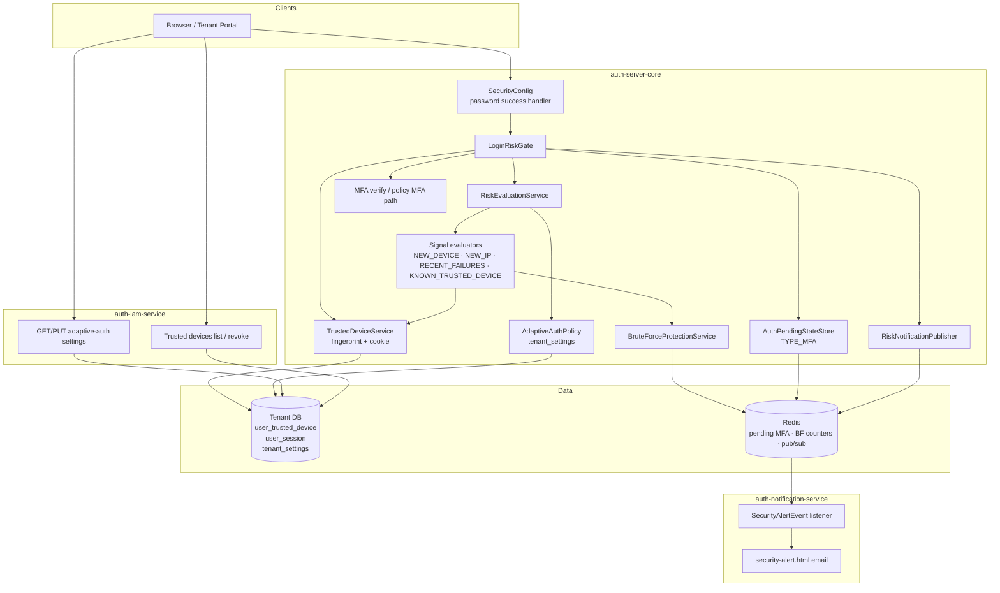
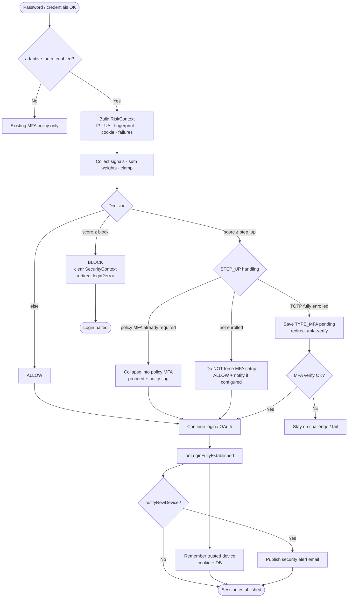
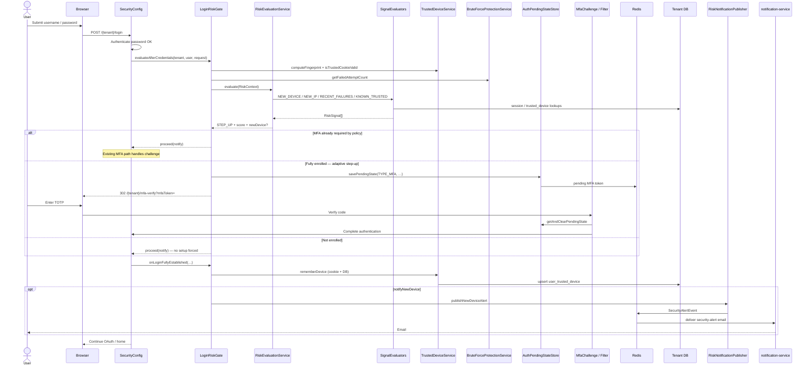
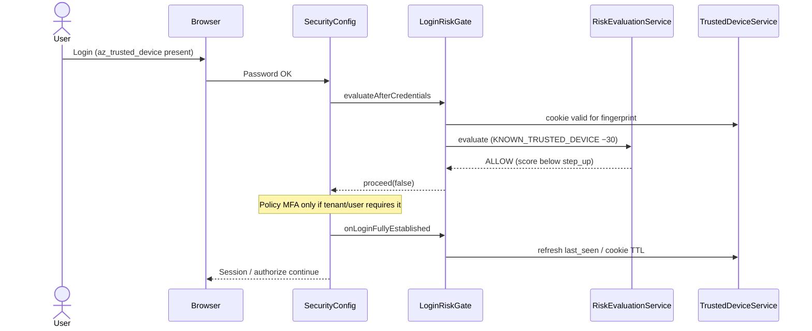
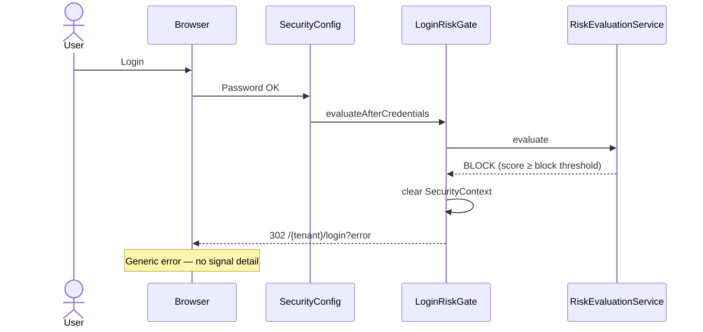
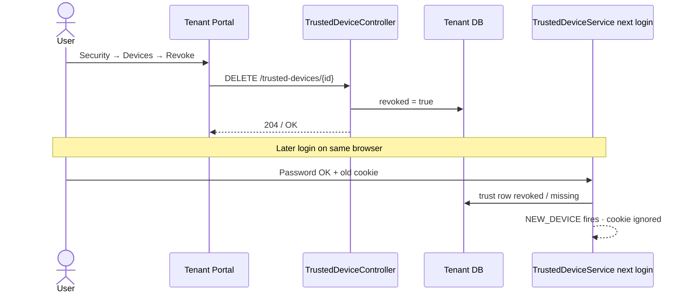

# Adaptive Auth — Phase A Diagrams

| Field | Value |
|-------|--------|
| Scope | **Phase A (MVP)** only — `NEW_DEVICE`, `NEW_IP`, `RECENT_FAILURES`; no GeoIP |
| Status | Shipped |
| Parent PRD | [Adaptive / Risk-Based Auth PRD](PRD.md) |
| Feature explanation | [FEATURES.md](FEATURES.md) — detailed behavior of each capability |
| Design | [`planning/designs/ADAPTIVE_RISK_BASED_AUTH_DESIGN.md`](../../../../planning/designs/ADAPTIVE_RISK_BASED_AUTH_DESIGN.md) §14 Phase A |
| Architecture | [`docs/ARCHITECTURE.md`](../../../ARCHITECTURE.md) §7 |

> **Read first:** [FEATURES.md](FEATURES.md) explains signals, decisions, trusted devices, step-up rules, email, and settings in product language. This file is the visual companion (architecture / flow / sequence).

---

## 1. Architecture (Phase A)

Components involved after password credentials succeed. Adaptive is **additive**: brute-force, captcha, policy MFA, and OAuth authorize stay unchanged when the flag is off.

### Module responsibilities (Phase A)

| Component | Role |
|-----------|------|
| `LoginRiskGate` | Post-credential gate: evaluate → BLOCK / STEP_UP / proceed; post-login trust + notify |
| `RiskEvaluationService` | Sum signal weights → clamp 0..100 → ALLOW / STEP_UP / BLOCK |
| Signal evaluators | Pluggable Phase A signals only (no Geo) |
| `TrustedDeviceService` | HMAC fingerprint, `az_trusted_device` cookie, DB trust row |
| `AuthPendingStateStore` | Reuses `TYPE_MFA` for adaptive step-up (no separate token type) |
| `RiskNotificationPublisher` | Redis → notification service for new-device / security alert |
| IAM APIs | Admin toggle + user device revoke |

---

## 2. Decision flow (Phase A)

High-level login path after **password OK**. Fail-open: unexpected evaluator/gate errors → continue normal login.

### Phase A signal weights (design defaults)

| Signal | Effect | Typical weight |
|--------|--------|----------------|
| `NEW_DEVICE` | No trusted match / no prior fingerprint | +40 |
| `NEW_IP` | IP not seen in lookback window | +15 |
| `RECENT_FAILURES` | BF failure density | +10..30 |
| `KNOWN_TRUSTED_DEVICE` | Valid trust cookie + fingerprint | −30 |

Thresholds (tenant settings): `adaptive_score_step_up` default **40**, `adaptive_score_block` default **80**.

---

## 3. Sequence — password login with STEP_UP (enrolled MFA)

Happy path when adaptive is on, score requires step-up, and the user has TOTP enrolled.

---

## 4. Sequence — ALLOW on known trusted device

---

## 5. Sequence — BLOCK

---

## 6. Sequence — revoke trusted device (portal)

Revoke removes **trust**, not the active session. Immediate logout remains session revoke.

---

## 7. Out of Phase A (not in these diagrams)

- GeoIP: `NEW_COUNTRY`, `IMPOSSIBLE_TRAVEL`
- `login_risk_event` audit table / admin viewer
- Email-OTP step-up for unenrolled users
- Social / passkey evaluation hooks
- Fail-closed as default (tenant can set later; Phase A gate still fail-open on unexpected errors)
- Continuous mid-session re-score (CAE)

See design doc §14 Phases B / C / D+.
