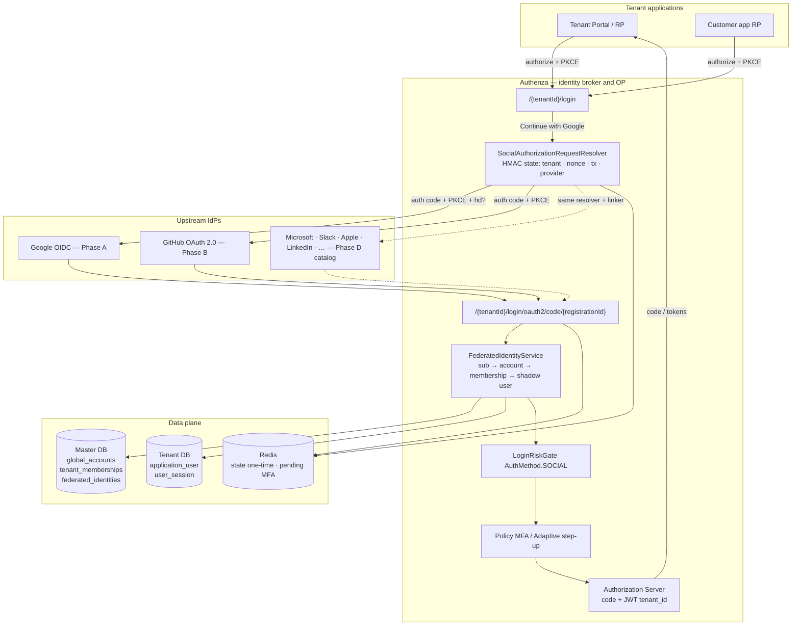
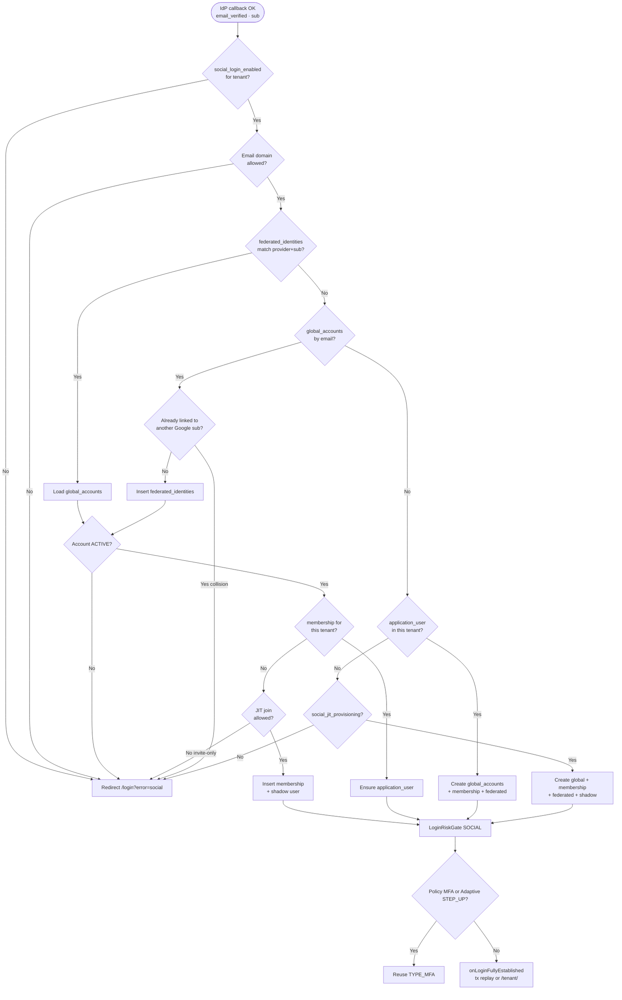
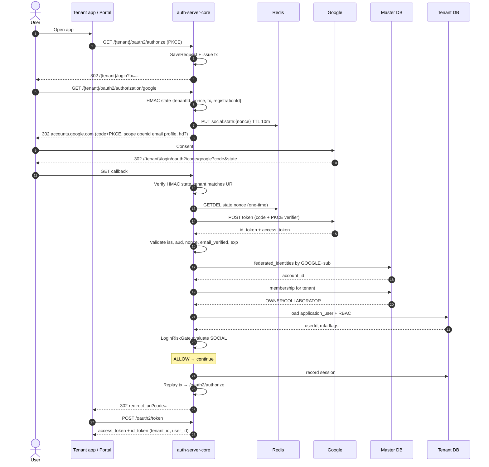
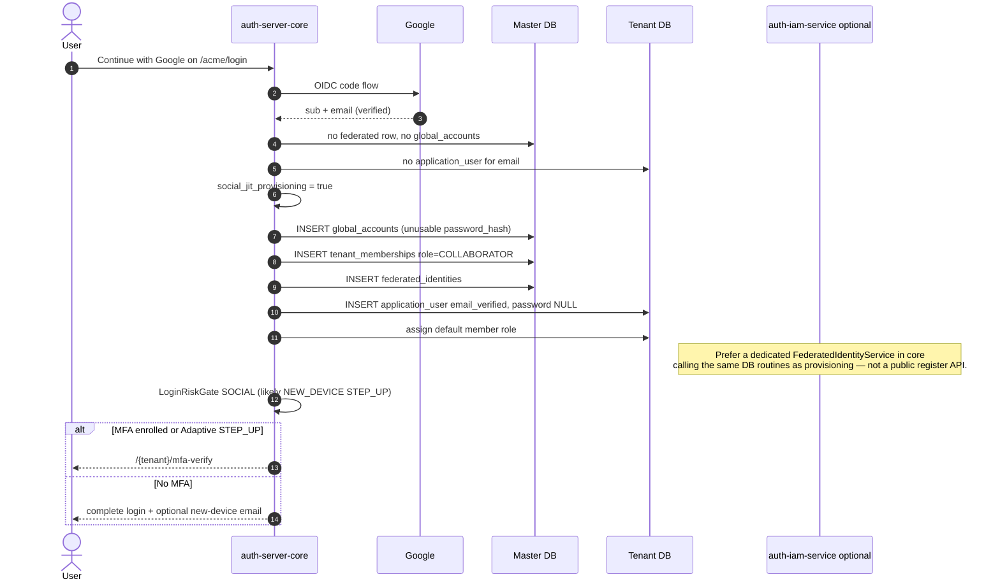
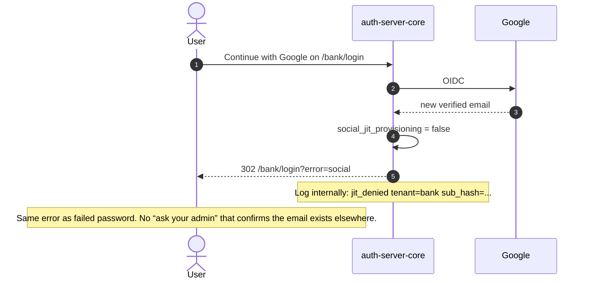
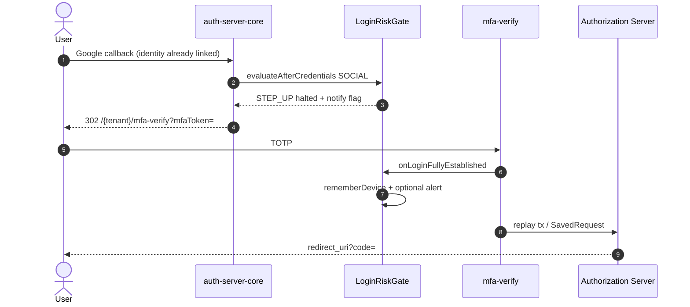
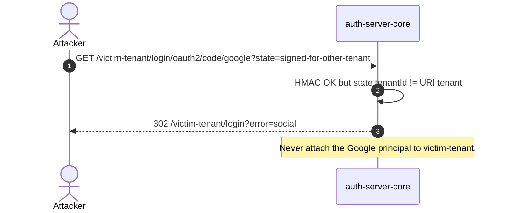

# Social Login — Identity Broker Design

| Field | Value |
|-------|--------|
| Status | Design — not implemented |
| Roadmap | [`planning/ROADMAP.md`](../ROADMAP.md) → Phase 3.5 → Social Login |
| Product PRD | [`docs/prd/phase-3-5-social-login-admin/social-login/PRD.md`](../../docs/prd/phase-3-5-social-login-admin/social-login/PRD.md) |
| Owner | Authenza Platform |
| Scope | **Identity broker** for consumer + enterprise IdPs. Ship **Google then GitHub**. Catalog (Microsoft, Slack, Apple, LinkedIn, …) uses the same pipeline later. Authenza remains the **OIDC provider** for tenant apps. |
| Out of scope (v1) | Implementing Microsoft / Slack / Apple in the first PRs; SAML catalog UI; per-tenant BYO Google Cloud project; social for M2M; replacing password login |

---

## 1. Problem

Tenant applications already trust **Authenza** as their OpenID Provider (`/{tenantId}/oauth2/authorize` → codes → JWTs with `tenant_id`). End users, especially in India SaaS, expect **Continue with Google** on the login page.

Naïve `oauth2Login()` is not enough:

1. **Wrong trust boundary** — if a tenant app talks to Google directly, Authenza is no longer the IdP and Adaptive / MFA / sessions / revoke stop applying.
2. **Wrong tenancy** — a single Google OAuth client + a shared `/login/oauth2/code/google` callback will mix tenants unless `state` is bound to `tenantId`.
3. **Wrong account model** — Authenza already has two identity tiers (`global_accounts` + `tenant_memberships` vs tenant `application_user`). Social must **join** that model, not create a third silo.

**Goal:** After Google (then GitHub) asserts a **verified email + stable subject**, Authenza resolves or provisions a tenant user and continues the **same** post-credential pipeline as password login (force-password-change skip, Adaptive `AuthMethod.SOCIAL`, policy MFA, session, `tx` replay).

---

## 2. Principles

1. **Broker, do not replace.** Tenant apps never receive Google tokens. They receive Authenza authorization codes / JWTs.
2. **Tenant is fixed before leaving Authenza.** The user clicked Google on `/{tenantId}/login`. That tenant is signed into OAuth `state`. Callback must not trust query params alone.
3. **`sub` is identity; email is a hint.** Link on provider subject first. Email is used for first-time match and JIT. Google can change email; `sub` does not.
4. **Verified email only.** Reject assertions where `email_verified != true` (Google) or GitHub primary email is unverified.
5. **No cross-tenant leakage.** Errors are generic (`login?error=social`). Do not say “this Google account belongs to tenant B.”
6. **Additive.** Password, passkey, brute-force, Adaptive, MFA stay. Social is another credential success path into `LoginRiskGate`.
7. **Fail closed on identity, fail open on extras.** If linking / membership cannot be established → deny login. If Adaptive evaluator throws → existing fail-open. If Google is down → show login page error, do not create users.
8. **Invite vs JIT is a tenant policy.** Open SaaS tenants may JIT-provision. Enterprise tenants default to **invite-only** (membership must already exist).

---

## 3. Current building blocks (reuse)

| Component | Reuse |
|-----------|--------|
| `/{tenantId}/login` + `tx` HMAC | Preserve originating OAuth2 authorize across Google round-trip |
| `JdbcTenantUserDetailsService` | Global membership then local `application_user` |
| `global_accounts` / `tenant_memberships` | Canonical email + which tenants the human may enter |
| `application_user` | Tenant RBAC, MFA enrollment, lockout, sessions |
| `LoginRiskGate` + `RiskContext.AuthMethod.SOCIAL` | Already on the enum; **not wired** |
| `AuthPendingStateStore` / MFA filter | Same step-up / policy MFA after social |
| `SessionRecordingService` | IP / UA after full login |
| `tenant_settings` + `TenantSettingsCache` | Per-tenant enable flags |
| `HmacSigner` | Sign social `state` the same way as `tx` / trust cookie |
| `auth-notification-service` | Optional “new social login / account linked” mail |

---

## 4. Architecture

Authenza sits in the middle: **client → Authenza OP → Google/GitHub IdP**.



### Why not stock Spring `oauth2Login()` alone

| Stock behavior | Authenza requirement |
|----------------|----------------------|
| One `ClientRegistration` , one callback | Callback **and** `state` must include `tenantId` |
| `DefaultOAuth2User` as the session principal | Principal must be `TenantUserDetails` (same as password) |
| Success → SavedRequest | Must also replay **`tx`** when session is gone |
| Auto-provision `OAuth2User` | Must run **link / JIT / invite-only** against master + tenant DBs |
| Shared `InMemoryClientRegistrationRepository` | Registrations from env **plus** later per-tenant BYO secrets |

Spring Security is still the right engine (`oauth2Login`, `OidcUserService`, success handler). Custom pieces: **request resolver, state codec, user service, success handler**.

---

## 5. Trust boundaries

```text
┌──────────────┐   Authenza JWT    ┌─────────────────┐   Google id_token    ┌────────┐
│ Tenant app   │ ◄──────────────── │ auth-server-core │ ◄────────────────── │ Google │
│ (RP)         │   never sees      │ (OP + broker)    │   never forwarded   │ (IdP)  │
│              │   Google tokens   │                  │   to the app        │        │
└──────────────┘                   └─────────────────┘                      └────────┘
```

| Token | Audience | Lifetime |
|-------|----------|----------|
| Google auth code | Authenza backend only | Seconds |
| Google id_token / access token | Authenza backend only; discard after linking | Minutes |
| Authenza `tx` | Login form / social state | Hours (existing) |
| Authenza authorize code | Tenant app | Existing AS settings |
| Authenza access / ID token | Tenant APIs | Existing customizer (`tenant_id`, `user_id`, roles) |

Google access tokens are **not** stored. Persist only `provider`, `issuer`, `subject`, linked account id.

---

## 6. Identity model

### 6.1 Layers

```text
Google sub  ──►  federated_identities  ──►  global_accounts.email
                                              │
                                              ▼
                                     tenant_memberships (this tenant?)
                                              │
                                              ▼
                                     application_user (shadow / local)
                                              │
                                              ▼
                                     TenantUserDetails → session / JWT
```

### 6.2 New table — `federated_identities` (master DB)

One human Google account must map to **one** `global_accounts` row, reusable across tenants via memberships.

| Column | Notes |
|--------|--------|
| `id` | PK |
| `account_id` | FK `global_accounts.id` ON DELETE CASCADE |
| `provider` | Extensible enum: `GOOGLE` \| `GITHUB` first; later `MICROSOFT`, `SLACK`, `APPLE`, `LINKEDIN`, … |
| `issuer` | e.g. `https://accounts.google.com` |
| `subject` | IdP `sub` (GitHub numeric id as string) |
| `email_at_link` | Snapshot; not unique |
| `created_at` / `last_login_at` | Audit |

Unique: `(provider, issuer, subject)`.

### 6.3 `global_accounts.password_hash`

Today the column is **NOT NULL** (password-centric admins). Social-only users have no password.

**MVP:** store an **unusable** hash (`{bcrypt}` of 32 random bytes, never logged). `JdbcTenantUserDetailsService` already treats some shadows as non-password.

**Follow-up migration:** nullable `password_hash` + `has_password` boolean so “set a password” is explicit. Do not block Google MVP on that migration.

### 6.4 Shadow `application_user`

Same pattern as tenant provisioning for owners:

- `email` / `preferred_username` = Google email
- `password` = `NULL` or sentinel `[GLOBAL_ACCOUNT]`
- default role: tenant **member** (not `TENANT_ADMIN`) for JIT; invited users keep invite role
- `email_verified = true` (asserted by Google)
- `mfa_enabled` unchanged (social does not skip MFA if already enrolled / tenant-required)

---

## 7. Tenant policy (`tenant_settings`)

| Key | Default | Meaning |
|-----|---------|---------|
| `social_login_enabled` | `false` | Master switch |
| `social_google_enabled` | `true` (when master on) | Show Google button |
| `social_github_enabled` | `false` | GitHub in Phase B |
| `social_jit_provisioning` | `true` for new SaaS tenants; **`false` recommended for enterprise** | Create account if unknown |
| `social_allowed_email_domains` | empty = any | CSV `acme.com,acme.co.in`; ignore `gmail.com` unless listed |
| `social_google_hosted_domain` | empty | Passed as Google `hd=`; Workspace lock-in |

IAM: `GET/PUT /api/v1/settings/social-login` (allow-list keys, same pattern as Adaptive).

Portal: Security → Authentication factors card (mirror Adaptive Auth page).

**Platform secrets** (not tenant DB): `app.social.google.client-id` / `client-secret`. Phase 5 may add per-tenant BYO client rows.

---

## 8. Decision flow (account linking)

After a **verified** IdP assertion, with `tenantId` taken from signed `state` (not from the user).



### Collision rules (enterprise)

| Situation | Action |
|-----------|--------|
| Same Google `sub` already linked | Always that `global_accounts` row |
| Email matches global account with **no** Google link | **Link** (account linking). Optional: email confirmation if we ever allow unverified IdPs — not in MVP. |
| Email matches global account **already linked to a different `sub`** | Deny. Possible takeover. |
| Email matches **local-only** `application_user` in this tenant | Promote / link (user can now use Google **or** password if hash exists). |
| Email exists only in **another** tenant’s local table | Do not search other tenant DBs. JIT or invite-only in **current** tenant only. |
| GitHub vs Google same email, two `sub`s | Two `federated_identities` rows, **one** `global_accounts` — allowed (same person, two IdPs). |

---

## 9. High-level login flow

```text
Tenant app                  Authenza                         Google
    │                           │                               │
    │  /oauth2/authorize        │                               │
    │──────────────────────────►│  login + tx                   │
    │                           │  user clicks Google           │
    │                           │──────────────────────────────►│
    │                           │     redirect + code           │
    │                           │◄──────────────────────────────│
    │                           │  link account                 │
    │                           │  Adaptive + MFA               │
    │  redirect_uri?code=       │                               │
    │◄──────────────────────────│                               │
    │  /oauth2/token            │                               │
    │──────────────────────────►│                               │
    │  Authenza JWT             │                               │
    │◄──────────────────────────│                               │
```

---

## 10. Sequence diagrams

### 10.1 Happy path — returning Google user, membership exists, Adaptive ALLOW



### 10.2 First Google login — JIT provision (SaaS tenant)



### 10.3 Enterprise invite-only — unknown Google user



### 10.4 Social + Adaptive STEP_UP + OAuth `tx` (new device)



If the user has **no** MFA enrollment, Phase A Adaptive rule still applies: **do not force `/mfa-setup`**. ALLOW + notify.

### 10.5 Stolen `state` / tenant mismatch (security)



---

## 11. HTTP surface

| Method | Path | Role |
|--------|------|------|
| GET | `/{tenantId}/oauth2/authorization/google` | Start Google (Spring registration id `google`) |
| GET | `/{tenantId}/oauth2/authorization/github` | Start GitHub (Phase B) |
| GET | `/{tenantId}/login/oauth2/code/{registrationId}` | Callback — **tenant in path** |
| GET | `/{tenantId}/login` | Buttons shown iff settings enabled |
| GET/PUT | `/api/v1/settings/social-login` | IAM admin |

Google Cloud console redirect URIs (platform client, MVP):

```text
http://localhost:8081/{tenantId}/login/oauth2/code/google
https://auth.example.com/{tenantId}/login/oauth2/code/google
```

Wildcard path per Google’s rules is limited. **MVP:** register explicit demo tenants + `*` documentation; **enterprise:** custom domain per tenant still uses the same path shape. If Google rejects wildcards, use a **single** callback `/login/oauth2/code/google` and **only** accept tenant from signed `state` (URI tenant optional). Prefer **tenant-in-path** when the IdP allows it — it matches `TenantValidationInterceptor`.

### Signed `state` payload

```text
Base64Url(JSON) + "." + Base64Url(HMAC-SHA256)
JSON: { tenantId, nonce, tx, registrationId, issuedAt, exp }
TTL: 10 minutes, Redis GETDEL(nonce) so state cannot be replayed
```

Reuse `HmacSigner` (`app.oauth-tx.hmac-secret` or `app.social.state-hmac-secret`).

---

## 12. Coding approach

### 12.1 Is this the best enterprise approach?

**Yes — with a plugin SPI on top of Spring `oauth2Login()`, not instead of it.**

Auth0, Okta, and Keycloak all sit in the same place: they are the **OP** the app trusts; Google/Microsoft/Slack are **upstream IdPs**. Spring Authorization Server + `oauth2Login()` is the standard Java way to broker that. Hand-rolling token HTTP, or a second `auth-social-service`, would fight our session, MFA, Adaptive, and `tx` pipeline.

What was *not* enterprise-ready in the first sketch: a Google-shaped adapter (`fromOidcUser` / `fromOAuth2User` on one interface). That forces every new IdP to pretend it is both OIDC and OAuth2. **OIDC vs OAuth2 is a real type split** (`OidcUserRequest`/`OidcUser` vs `OAuth2UserRequest`/`OAuth2User`) — this is where **bounded generics** belong. Linking, Adaptive, and JWT completion stay **non-generic** (`SocialAssertion` → `TenantUserDetails`).

| Layer | Pattern | Generic? |
|-------|---------|----------|
| Protocol | Spring `oauth2Login()` once in `SecurityConfig` | No — Spring already genericized this |
| Plugin catalog | `SocialProviderPlugin<TRequest, TUser>` + enum + registry | **Yes** (request/user types differ) |
| Claim mapping | Plugin `extract(TUser)` → `SocialAssertion` | Type param on the plugin only |
| Account linking | `FederatedIdentityService` | **No** — always one assertion / one account model |
| Login completion | `SocialLoginCompletionService` | **No** — always `TenantUserDetails` |
| Whole pipeline | `SocialLoginService<TIdp, TToken, TUser>` | **Never** — speculative; Adaptive already rejected this shape |

### 12.2 Plugin SPI (enum + interface + generics + abstract bases)

```java
/** Catalog. Phase A uses GOOGLE only; other constants exist so settings/UI can list them. */
public enum SocialProviderId {
    GOOGLE, GITHUB, MICROSOFT, SLACK, APPLE, LINKEDIN, FACEBOOK, TWITTER;

    public String registrationId() { return name().toLowerCase(Locale.ROOT); }
    public String settingKey() { return "social_" + registrationId() + "_enabled"; }
}

public enum SocialProtocol { OIDC, OAUTH2 }

/**
 * One Spring bean per IdP. Adding Microsoft/Slack = a new @Component, no SecurityConfig change.
 * TRequest/TUser are Spring's OIDC vs OAuth2 types — the only justified generics here.
 */
public interface SocialProviderPlugin<
        TRequest extends OAuth2UserRequest,
        TUser extends OAuth2User> {

    SocialProviderId id();
    SocialProtocol protocol();
    boolean enabledByDefault();

    /** Platform (env) ClientRegistration. Phase D may overlay tenant secrets. */
    ClientRegistration clientRegistration(SocialAuthProperties properties);

    SocialAssertion extract(TUser user);
}

public abstract class AbstractOidcProviderPlugin
        implements SocialProviderPlugin<OidcUserRequest, OidcUser> {
    @Override public final SocialProtocol protocol() { return SocialProtocol.OIDC; }

    @Override
    public SocialAssertion extract(OidcUser user) {
        // Common: iss, sub, email, email_verified. Subclasses override map() for hd/tid/Apple relay.
        return map(user.getIdToken(), user);
    }

    protected abstract SocialAssertion map(OidcIdToken idToken, OidcUser user);
}

public abstract class AbstractOAuth2ProviderPlugin
        implements SocialProviderPlugin<OAuth2UserRequest, OAuth2User> {
    @Override public final SocialProtocol protocol() { return SocialProtocol.OAUTH2; }
}
```

**Phase A plugin**

```java
@Component
public class GoogleOidcPlugin extends AbstractOidcProviderPlugin {
    @Override public SocialProviderId id() { return SocialProviderId.GOOGLE; }
    // ClientRegistration.withProviderConfiguration(CommonOAuth2Provider.GOOGLE) + our redirect template
    // extract: require email_verified; optional hosted-domain check against policy
}
```

**Later plugins (no pipeline change)**

| IdP | Extends | Extra in `extract` |
|-----|---------|-------------------|
| Microsoft | `AbstractOidcProviderPlugin` | `tid` vs `social_microsoft_tenant`; `preferred_username` |
| Apple | `AbstractOidcProviderPlugin` | Hide-My-Email; first-login name from `user` form field |
| GitHub | `AbstractOAuth2ProviderPlugin` | Primary *verified* email from `/user/emails` |
| Slack | `AbstractOAuth2ProviderPlugin` | `https://slack.com/api/users.identity`; team id if we lock a workspace |

### 12.3 Registry — SecurityConfig is wired **once**

Spring injects `List<SocialProviderPlugin<?, ?>>`. A registry indexes by `SocialProviderId` and `registrationId`.

```java
@Component
public class SocialProviderRegistry {
    private final Map<SocialProviderId, SocialProviderPlugin<?, ?>> byId;

    public SocialProviderRegistry(List<SocialProviderPlugin<?, ?>> plugins) { /* unique id() */ }

    public Optional<SocialProviderPlugin<?, ?>> get(SocialProviderId id) { ... }
    public List<ClientRegistration> registrations(SocialAuthProperties props) { ... }
}
```

**Delegating user services** (the plugin lookup):

```java
public class DelegatingSocialOidcUserService implements OAuth2UserService<OidcUserRequest, OidcUser> {
    // loadUser: registrationId → plugin; if protocol != OIDC → fail
    // call DefaultOidcUserService then plugin.extract((OidcUser) user); stash assertion in request attribute
}

public class DelegatingSocialOAuth2UserService implements OAuth2UserService<OAuth2UserRequest, OAuth2User> {
    // same for GitHub/Slack plugins
}
```

`SecurityConfig` does **not** mention Google:

```java
http.oauth2Login(oauth -> {
    oauth.authorizationEndpoint(a -> a
            .baseUri("/{tenantId}/oauth2/authorization")
            .authorizationRequestResolver(socialAuthorizationRequestResolver));
    oauth.redirectionEndpoint(r ->
            r.baseUri("/{tenantId}/login/oauth2/code/*"));
    oauth.userInfoEndpoint(u -> u
            .oidcUserService(delegatingSocialOidcUserService)
            .userService(delegatingSocialOAuth2UserService));
    oauth.successHandler(socialAuthenticationSuccessHandler);
    oauth.failureHandler(socialAuthenticationFailureHandler);
});
```

```text
AuthorizationServerConfig  @Order(1)   /oauth2/authorize, /oauth2/token   UNCHANGED
SecurityConfig             @Order(2)   formLogin + oauth2Login + MFA
                                         │
                                         ├─ GET  /{tenant}/oauth2/authorization/{registrationId}
                                         └─ GET  /{tenant}/login/oauth2/code/{registrationId}
```

`loginPage` stays `/{tenantId}/login`. CSRF: still ignore only `/{tenantId}/login`; callback GET is protected by HMAC `state` + Redis nonce.

**Permit** authorization + callback matchers. Tenant URI filter must run first so `TenantContextHolder` is set before linking.

Login page: loop `registry` × tenant flags — new plugin automatically gets a button when `social_<id>_enabled=true`.

### 12.4 Package layout

```text
com.authenza.core.social
  SocialProviderId.java                 enum (full catalog)
  SocialProtocol.java                   enum OIDC | OAUTH2
  SocialAssertion.java                  record (stable; never generic)
  SocialAuthProperties.java
  SocialAuthPolicy.java
  SocialProviderRegistry.java
  SocialStateCodec.java                 HMAC + Redis GETDEL (HmacSigner)
  SocialAuthorizationRequestResolver.java
  DelegatingSocialOidcUserService.java
  DelegatingSocialOAuth2UserService.java
  FederatedIdentityService.java         §8 — takes SocialAssertion only
  SocialLoginCompletionService.java
  SocialAuthenticationSuccessHandler.java
  SocialAuthenticationFailureHandler.java
  plugin/
    SocialProviderPlugin.java           generic SPI
    AbstractOidcProviderPlugin.java
    AbstractOAuth2ProviderPlugin.java
    GoogleOidcPlugin.java               Phase A — the only concrete plugin in PR 1
```

IAM: `SocialAuthSettings` constants + `GET/PUT /api/v1/settings/social-login`.

### 12.5 How to add an IdP later (checklist)

1. Add/confirm `SocialProviderId.SLACK` (already on the enum).
2. `SlackOAuth2Plugin extends AbstractOAuth2ProviderPlugin` (`@Component`).
3. Env `app.social.slack.client-id` / `client-secret`.
4. Seed `social_slack_enabled=false`.
5. Tests for `extract` (verified email). **Do not** edit `SecurityConfig`, linker, or Adaptive gate.

If a future IdP is **SAML** (not OAuth2), that is a **new protocol enum value + a SAML filter chain**, not a fake `SocialProviderPlugin<OAuth2UserRequest, ?>`. Do not stretch the OAuth2 generic to SAML.

### 12.6 Client registrations

Phase A/B: **platform** Google/GitHub apps in env, not tenant DB.

```yaml
app:
  social:
    google:
      client-id: ${GOOGLE_CLIENT_ID}
      client-secret: ${GOOGLE_CLIENT_SECRET}
      scopes: openid,email,profile
    github:
      client-id: ${GITHUB_CLIENT_ID:}
      client-secret: ${GITHUB_CLIENT_SECRET:}
      scopes: read:user,user:email
```

Built from `SocialProviderRegistry.registrations(properties)` — **every plugin contributes one `ClientRegistration`**. Redirect URI template: `{baseUrl}/{tenantId}/login/oauth2/code/{registrationId}`.

Phase D BYO: `TenantAwareClientRegistrationRepository` overlays per-tenant secrets — **not** in the Google PR.

### 12.7 Principal conversion (critical)

Spring’s default success leaves `OidcUser` / `OAuth2User` in `SecurityContext`. Authenza JWTs, MFA, and Adaptive all expect **`TenantUserDetails`**.

Success path:

1. Adapter → `SocialAssertion` (reject if `!emailVerified`).
2. `FederatedIdentityService.resolveOrProvision(tenantId, assertion)` → `userId`.
3. `JdbcTenantUserDetailsService.loadUserByUsername(email)` → `TenantUserDetails`.
4. Replace authentication with `UsernamePasswordAuthenticationToken(userDetails, null, authorities)` (or a dedicated `SocialAuthenticationToken` if we need `AuthMethod` on the Authentication). Simpler MVP: reuse username/password token **after** credentials are already proven by the IdP — same as MFA filter does today after TOTP.
5. `SocialLoginCompletionService.complete(...)` **copies the password success handler** (force-pwd skip for social-only, `LoginRiskGate` with `AuthMethod.SOCIAL`, policy MFA, `onLoginFullyEstablished`, `tx` replay). Extract shared “after credentials OK” from `SecurityConfig` into that service so password and social cannot drift.

Do not call `OidcUser.getName()` as the Authenza username. Always the linked `application_user.preferred_username` / email.

### 12.8 Data access

| Store | Access |
|-------|--------|
| `federated_identities`, `global_accounts`, `tenant_memberships` | Master `JdbcTemplate` (`@Qualifier` master datasource), same as `JdbcTenantUserDetailsService` global query |
| `application_user` | Tenant-routed `JdbcTemplate` (context already set from URI) |
| State nonce | Redis `social:state:{nonce}` TTL 10m, `GETDEL` |

`FederatedIdentityService` is `@Transactional` on master for insert of account + membership + federated row; then tenant insert for shadow user. If tenant insert fails, do not leave an orphan membership without a user — catch and fail login (fail **closed** on identity).

### 12.9 Login UI

Thymeleaf `login.html`: if master `social_login_enabled`, loop plugins whose tenant flag is on. Each button is GET `/{tenantId}/oauth2/authorization/{registrationId}` (`tx` goes in signed `state` via the resolver). A new plugin shows a button with **no HTML hard-coding of Google**. Hide the whole block when the master flag is off.

### 12.10 First PR file set (SPI + Google plugin only)

1. Liquibase master: `federated_identities`; tenant: social settings seeds (`false`).
2. `auth-common`: `SocialProviderId`, `SocialProtocol`, `SocialAuthSettings`.
3. SPI: `SocialProviderPlugin`, both abstract bases, `SocialProviderRegistry`, delegating user services.
4. **One** plugin: `GoogleOidcPlugin`.
5. Linker + completion + handlers; `SecurityConfig.oauth2Login` wired to **delegates only**.
6. `login.html` buttons from registry × flags.
7. IAM GET/PUT social-login.
8. Tests: registry uniqueness; Google `extract`; linker matrix; state HMAC; one WireMock callback.

GitHub / Microsoft / Slack PRs = plugin class + env + setting. Zero changes to `SecurityConfig`.

---

## 13. Adaptive, MFA, brute-force

| Control | Social behavior |
|---------|-----------------|
| Brute-force password counter | **Does not increment** on Google failure (IdP-side). Still applies if user later types password. |
| Adaptive | `AuthMethod.SOCIAL`. `NEW_DEVICE` / `NEW_IP` still apply. Consider later: slightly lower weight when Google `sub` is already linked **and** cookie trusted. MVP: **same weights**. |
| Policy MFA | Unchanged. Enrolled / required users still verify TOTP. |
| Force password change | Skip when `password_hash` is unusable / `has_password=false`. |
| Trusted device cookie | Written on full login, same as password. |

---

## 14. Security controls (enterprise checklist)

| Risk | Control |
|------|---------|
| Account takeover via unverified Google email | Require `email_verified=true` |
| Tenant mix-up | HMAC `state.tenantId` + Redis nonce one-time |
| Login CSRF | `state` nonce; existing cookie CSRF unused on IdP redirect |
| Auth code interception | PKCE to Google; Authenza→app already PKCE for portal |
| Token stuffing of Google JWT | Validate `aud` = our client id, `iss`, `exp`, `nonce` |
| JIT storm / abuse | Rate-limit start URL per IP + tenant; invite-only for enterprise |
| Email domain bypass | Allow-list compared on **normalized** domain; `hd` as extra Google hint, not the only check |
| Secret in tenant DB | Platform secrets in env / secret manager for MVP |
| PII in logs | Log `sub` hashed, never id_token |
| Redirect open | `tx` already signed; do not take `redirect_uri` from Google |

DPDP / privacy: IdP tokens not stored; email lives in tenant + master as today; document Google as processor in later `DPDP_COMPLIANCE.md`.

---

## 15. Phased delivery

### Phase A — Google MVP (implement next)

1. Settings keys + IAM GET/PUT + portal toggle (off by default).
2. Platform Google client + tenant-in-path (or state-only) callback.
3. Signed state + PKCE + nonce.
4. `federated_identities` table.
5. Link / JIT / invite-only algorithm.
6. Success handler → existing MFA + **wire `LoginRiskGate` with `SOCIAL`**.
7. Login page button when enabled.
8. Tests: returning user, JIT, invite-only deny, tenant mismatch, unverified email.

### Phase B — GitHub

Same linker. Extra: verified primary email from API. No `hd`.

### Phase C — Hardening

- Email domain allow-list UI
- `social_google_hosted_domain`
- Audit row `login_method=GOOGLE` (can wait for Phase 5 audit framework)
- Account-link confirmation when local password user first uses Google (optional step-up)

### Phase D — Famous-provider catalog (roadmap Phase 5)

Same `FederatedIdentityService`, signed `state`, Adaptive/MFA, `tx` replay. Each new brand is a **registration + claim adapter**, not a new login pipeline.

| Provider | Protocol | Why it exists | Add when |
|----------|----------|---------------|----------|
| **Microsoft** (Entra ID / Azure AD / personal MSA) | OIDC | B2B / Workspace-equivalent; `hd`-like tenant restriction via `tid` | Paying enterprise or India IT/fintech ask |
| **Slack** | OAuth 2.0 (not OIDC) | Product/SaaS users already in Slack | A customer’s workforce lives in Slack |
| **Apple** | OIDC + privacy relay email | iOS apps; Hide My Email must be stored as the linked email | Mobile RP or App Store requirement |
| **LinkedIn** | OAuth 2.0 | Professional / HR SaaS | A tenant asks for it |
| **Facebook / Meta** | OAuth 2.0 | Consumer B2C | Explicit B2C tenant demand |
| **X (Twitter)** | OAuth 2.0 | Consumer | Same as Meta — not default |
| Generic **OIDC / SAML** | OIDC or SAML 2.0 | Okta, Ping, custom Entra apps, ADFS | Phase 5 IdP catalog UI + BYO client ids |

**Do not** ship Slack/Microsoft buttons in Phase A. The table `federated_identities.provider` and `SocialAuthPolicy` flags (`social_<provider>_enabled`) are designed so a later PR only adds:

1. Spring `ClientRegistration` (client id/secret, scopes, user-info URI)
2. A small adapter: “give me `sub` + verified email” (OIDC `id_token` vs Slack `users.identity` / GitHub `/user/emails`)
3. Login-page button + tenant toggle

**Promote a catalog row to Now only when:** a paying or pilot customer names that IdP, or an app-store / compliance rule requires it (Apple).

---

## 16. Testing strategy

| Layer | Cases |
|-------|--------|
| Unit | State HMAC round-trip; linking matrix (sub hit, email link, collision, JIT, invite-only, domain deny) |
| Integration | Mock Google token endpoint; callback creates membership; second login does not duplicate `application_user` |
| Multi-tenant | State for `acme` posted to `bank` callback → error, no session |
| Adaptive | Social new device → STEP_UP if enrolled; unenrolled → no `/mfa-setup` |
| OIDC | Portal authorize → Google → code returned to portal `redirect_uri` |
| Negative | `email_verified=false`; expired state; replayed nonce |

---

## 17. Open decisions

1. **Callback shape:** tenant in path vs single `/login/oauth2/code/google` (depends on Google Cloud redirect URI limits in prod).
2. **JIT default:** `true` for GTM demo tenants, `false` for anything labeled enterprise — pick at provisioning time.
3. **JIT role:** `COLLABORATOR` on membership vs a new `MEMBER` platform role (today membership only has OWNER/COLLABORATOR). Prefer **COLLABORATOR** for MVP; add `MEMBER` when RBAC UI exists.
4. **Linking local password users:** silent link (MVP) vs “confirm with password once.”
5. **Nullable `password_hash`:** sentinel now vs migration in the same PR as Google.

---

## 18. Success criteria

- From `/{tenantId}/login`, with social enabled, **Continue with Google** returns the user to the **originating app** with an Authenza code (not a Google token).
- Second Google login of the same `sub` does not create a second `application_user`.
- Invite-only tenant: unknown Google email never creates rows in master or tenant DB.
- Adaptive Phase A still holds: new device can step-up; unenrolled users are not forced into MFA setup.
- Cross-tenant state tampering never establishes a session.

---

## 19. Suggested implementation order (first PR)

1. Liquibase `federated_identities` + settings seeds (`social_login_enabled=false`).
2. `SocialAuthPolicy` + IAM settings API.
3. State codec + authorization request resolver + callback.
4. `FederatedIdentityService` + tests for the decision tree.
5. Success handler hooked to `LoginRiskGate` / MFA / `tx`.
6. Login HTML button + portal settings card.
7. Wire GitHub behind the same service in a follow-up PR.
