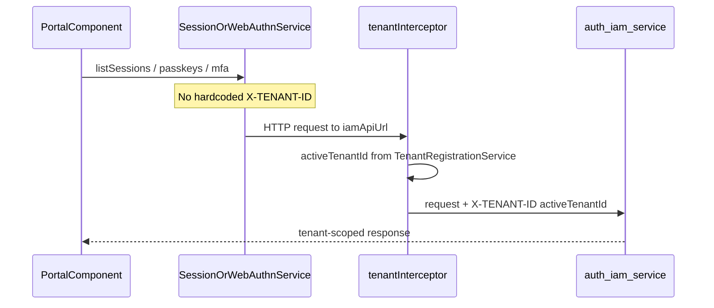
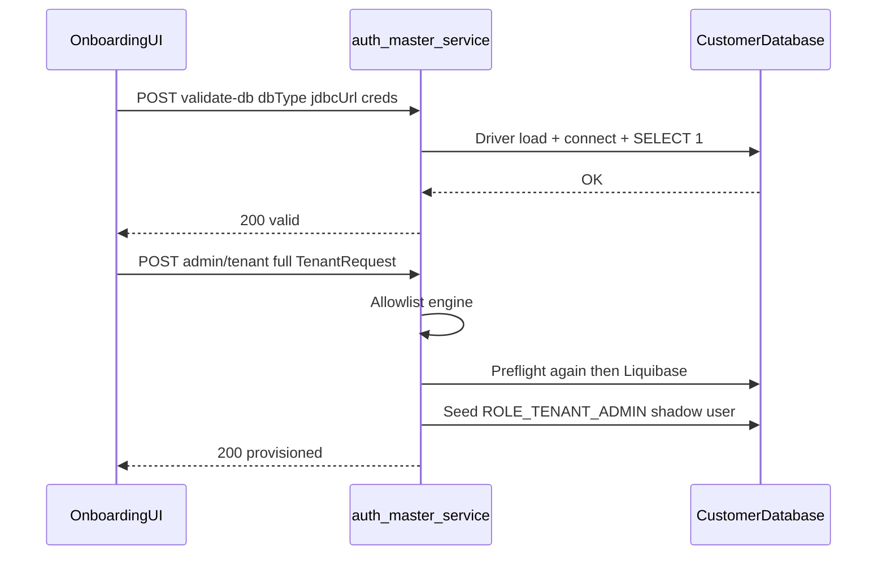

# Design & Implementation Plan: BYOD Tenant Databases + Portal Must-Fix Hardening

**Status:** Implementation in progress (PR-1…PR-5 code landed)  
**Repos:** `authenza-auth-server` + `authenza-tenant-portal`  
**Author:** Authenza Engineering  
**Date:** 2026-10-14  
**Execution checklist:** [byod_and_portal_tenant_context_implementation.md](./byod_and_portal_tenant_context_implementation.md)

---

## 1. Executive Summary

This document defines a **backward-compatible** design and phased implementation plan for two must-fix workstreams:

1. **Portal IAM tenant-context correctness** — stop hardcoding `X-TENANT-ID: system-admin` on sessions / MFA / passkeys so IAM calls follow the active tenant (same as users/settings already do).
2. **BYOD (Bring Your Own Database)** — let customers provision a tenant against their own **MySQL**, **PostgreSQL**, or **MariaDB**, with preflight validation, driver support, and dialect-safe runtime SQL.

**Compatibility north star:** every change must leave today’s default paths unchanged:

- OIDC login against `…/system-admin` continues to work.
- Tenant registration **without** `jdbcUrl` continues to auto-create a MySQL database on the platform host.
- Portal default `activeTenantId` remains `system-admin`.

---

## 1.1 Scope Decision Record (Locked)

This section records only what is **in scope** for this design.

| Lock | Choice | What it means |
|---|---|---|
| **1A** | Must-fix portal IAM headers + env safety + BYOD | Drop hardcoded `system-admin` on IAM calls; add prod/QA `authBaseUrl`; deliver BYOD for MySQL / PostgreSQL / MariaDB. OIDC authority stays on `system-admin`. |
| **2A** | Design + implementation plan first | Doc was written first; application code for Phases 1–4 follows the execution checklist when requested. |

```text
Scope lock: 1A + 2A
```

**Preserved as-is (not redesigned):** the portal’s existing tenant switcher (`tenant-switcher.component.ts` + `POST /api/v1/admin/tenant/{tenantId}/switch`) keeps working the way it does today — list tenants, update last-accessed, set active tenant, navigate/`reload`. This plan must **not break** that path.

Anything else not listed above is out of scope for this plan — see §2.

---

## 2. Non-Goals (Explicitly Out of Scope)

> **Important:** “Out of scope” means we do **not enhance or redesign** tenant switching. The **current / normal switcher in the portal remains**. We only avoid new work such as re-auth-on-switch or session-bleed enforcement.

| Item | Reason |
|---|---|
| Redesigning tenant-switcher UX or changing switch API semantics | Current switcher stays; no productization in this plan |
| Dynamic OIDC authority / re-auth on tenant switch | Enhancement — not part of lock 1A |
| `CROSS_TENANT_SESSION_BLEED` / principal-vs-path enforcement | Explicitly out of scope by product decision |
| Oracle / MSSQL / IBM DB2 as supported BYOD engines | Enum may retain values; provision API must reject them |
| Full RBAC / `@PreAuthorize` re-enable | Separate later plan |
| Moving platform master DB or `system-admin` off MySQL | Platform invariant unchanged |
| Immediate Phase 1 code changes upon publishing this doc | Lock 2A is doc-only until implementation is requested |

---

## 3. Current-State Gaps

### 3.1 P1 — Portal IAM calls pin `system-admin`

Users and settings already inherit tenant context from the interceptor. Sessions / MFA / passkeys bypass it.

| File | Gap |
|---|---|
| `authenza-tenant-portal/src/app/core/services/session.service.ts` | Forces `X-TENANT-ID: system-admin` via `MASTER_TENANT_ID` |
| `authenza-tenant-portal/src/app/core/services/session-guard.service.ts` | Same hardcoded header for session polling |
| `authenza-tenant-portal/src/app/core/services/webauthn.service.ts` | Most MFA/passkey calls force `system-admin` |
| `authenza-tenant-portal/src/app/core/interceptors/tenant.interceptor.ts` | Correctly sets `X-TENANT-ID` from `activeTenantId`, but skipped when header already present |
| `authenza-tenant-portal/src/app/core/services/tenant-registration.service.ts` | Default stored/active tenant is `system-admin` (keep) |

**OIDC authority** remains `http://localhost:8081/system-admin` (dev) / `…/system-admin` (prod/QA). This plan does **not** change issuer binding.

### 3.2 P2 — Prod / QA env gaps

| File | Gap |
|---|---|
| `authenza-tenant-portal/src/environments/environment.ts` | Missing `authBaseUrl`; no `secureRoutes` |
| `authenza-tenant-portal/src/environments/environment.qa.ts` | Same |
| `authenza-tenant-portal/src/environments/environment.development.ts` | Complete (`authBaseUrl: http://localhost:8080`) — keep as reference |

Without `authBaseUrl`, `TenantRegistrationService` and platform-admin detection in `tenant.interceptor.ts` break outside local dev.

### 3.3 P3 — BYOD incomplete for advertised engines

| Area | Current state | Gap |
|---|---|---|
| API contract | `TenantRequest` already has `dbType`, `jdbcUrl`, `username`, `password`, `driver` (`auth-common/.../TenantRequest.java`) | No engine allowlist; unsupported engines can be requested |
| Provisioning | `TenantProvisioningService.onboardNewTenant` auto-resolves driver; empty `jdbcUrl` → platform MySQL | No preflight connectivity check before Liquibase |
| Drivers | `auth-tenant-adapter/build.gradle` has MySQL + PostgreSQL (+ Oracle) | **MariaDB JDBC driver missing** |
| SQL reports | `auth-tenant-schema/build.gradle` `generateSqlReports` maps mysql/postgresql/oracle/mssql | MariaDB missing from report map |
| Runtime SQL | Partial ANSI cleanup done (`CURRENT_TIMESTAMP`, dropped many `LIMIT`s) | Remaining `LIMIT 1` in tenant-path SQL: `SessionRecordingService.java`, `AuthorizationServerConfig.java` |
| Portal UX | Onboarding posts `{ ownerId, accountType: 'PERSONAL' }` only | No BYOD fields; company path unfinished |
| Validation API | None | No `validate-db` endpoint |

**Platform invariant (unchanged):**

- Master DB (`auth-master`) stays MySQL.
- `system-admin` tenant DB stays platform-managed MySQL.
- BYOD applies only to **customer tenant** databases.

---

## 4. Target Design

### 4.1 Runtime topology

```text
Tenant Portal :4200
  │
  ├─ OIDC (unchanged) ──────────────► auth-server-core :8081 /system-admin
  │
  ├─ IAM APIs + X-Tenant-ID ────────► auth-iam-service :8082
  │   (activeTenantId via interceptor)
  │
  └─ Admin tenant APIs ─────────────► auth-master-service :8080
       POST /api/v1/admin/tenant/validate-db   (new)
       POST /api/v1/admin/tenant               (existing, hardened)

auth-master-service
  ├─ allowlist engine (MYSQL | POSTGRES | MARIADB)
  ├─ preflight connect + SELECT 1
  ├─ Liquibase tenant changelog
  ├─ seed OWNER shadow user
  └─ Redis TenantProvisionedEvent
         │
         ▼
auth-tenant-adapter registers Hikari pool in core + IAM
         │
         ▼
Customer BYOD DB  (MySQL / PostgreSQL / MariaDB)
```

### 4.2 IAM header path (after Phase 1)



Default `activeTenantId = system-admin` ⇒ today’s portal login flow is behaviorally identical.

### 4.3 BYOD provision path (after Phase 2–3)



Hosted path (no `jdbcUrl`) remains:

1. Derive `jdbc:mysql://…/{tenantId}…` from master URL  
2. Use master credentials / MySQL driver  
3. Liquibase + seed + Redis event  

---

## 5. API Contracts

### 5.1 Existing — `POST /api/v1/admin/tenant`

Controller: `auth-master-service/.../TenantRegistrationController.java`  
DTO: `auth-common/.../TenantRequest.java`

```json
{
  "tenantId": "acme-corp",
  "dbType": "POSTGRES",
  "jdbcUrl": "jdbc:postgresql://db.customer.com:5432/acme_auth",
  "username": "acme_user",
  "password": "***",
  "driver": null,
  "ownerId": "owner@example.com",
  "accountType": "COMPANY",
  "orgName": "Acme Corp",
  "employeeRange": "11-50",
  "isDefault": true
}
```

**Compatibility rules:**

| Input | Behavior |
|---|---|
| `jdbcUrl` null/blank | Platform MySQL auto-provision (today’s path) — **unchanged** |
| `dbType` null + blank `jdbcUrl` | Treat as `MYSQL` (today’s path) |
| `dbType` in `{MYSQL, POSTGRES, MARIADB}` + `jdbcUrl` set | BYOD path |
| `dbType` in `{ORACLE, MSSQL, IBMDB2}` + `jdbcUrl` set | **400** — unsupported engine |
| `driver` null | Auto-resolve from `DBType.getDefaultDriver()` (already implemented) |

**Response hardening (implementation note):** prefer structured JSON (`tenantId`, `status`) while keeping a text body fallback or dual content-type only if portal already parses text — portal today tolerates both JSON and plain text in `onboarding.component.ts`. Prefer returning JSON:

```json
{ "tenantId": "acme-corp", "status": "PROVISIONED", "dbType": "POSTGRES" }
```

without removing the ability for older clients to read a success body.

### 5.2 New — `POST /api/v1/admin/tenant/validate-db`

Non-mutating preflight. Does **not** insert master rows or run Liquibase.

**Request:**

```json
{
  "dbType": "MARIADB",
  "jdbcUrl": "jdbc:mariadb://db.customer.com:3306/acme_auth",
  "username": "acme_user",
  "password": "***",
  "driver": null
}
```

**Success (200):**

```json
{
  "valid": true,
  "dbType": "MARIADB",
  "resolvedDriver": "org.mariadb.jdbc.Driver",
  "productName": "MariaDB",
  "productVersion": "11.4.2"
}
```

**Failure (400):**

```json
{
  "valid": false,
  "errorCode": "DB_AUTH_FAILED",
  "message": "Authentication failed for supplied credentials"
}
```

Suggested `errorCode` values:

| Code | Meaning |
|---|---|
| `UNSUPPORTED_ENGINE` | Not MYSQL / POSTGRES / MARIADB |
| `INVALID_JDBC_URL` | Unparseable / wrong scheme for dbType |
| `DRIVER_MISSING` | Driver class not on classpath |
| `DB_UNREACHABLE` | Timeout / network |
| `DB_AUTH_FAILED` | Bad username/password |
| `DB_PRIVILEGE` | Connect works but cannot create/alter tables (best-effort check) |
| `DB_QUERY_FAILED` | `SELECT 1` failed for other reasons |

### 5.3 Supported engines (GA)

| `DBType` value | JDBC URL prefix (examples) | Default driver |
|---|---|---|
| `MYSQL` | `jdbc:mysql://…` | `com.mysql.cj.jdbc.Driver` |
| `POSTGRES` | `jdbc:postgresql://…` | `org.postgresql.Driver` |
| `MARIADB` | `jdbc:mariadb://…` (also accept `jdbc:mysql://` if `dbType=MARIADB`) | `org.mariadb.jdbc.Driver` |

`DBType.parse(...)` already maps aliases; provisioning must still **allowlist** after parse.

---

## 6. Compatibility & Rollback Rules

### 6.1 Must not break

1. Local/dev portal login via `authority = …/system-admin`.
2. Sessions / MFA / passkeys for a user operating under `activeTenantId = system-admin`.
3. `POST /api/v1/admin/tenant` with only `{ ownerId, accountType: "PERSONAL" }` (hosted MySQL).
4. Existing Redis `TenantProvisionedEvent` consumers in `auth-tenant-adapter`.
5. Liquibase changelog history on already-provisioned MySQL tenant DBs.

### 6.2 Safe change patterns

| Change | Why safe |
|---|---|
| Remove hardcoded `X-TENANT-ID` when default tenant is `system-admin` | Interceptor emits the same value |
| Add MariaDB driver `runtimeOnly` | Additive classpath; unused unless BYOD MariaDB |
| Add `validate-db` endpoint | New route; no callers required |
| Reject unsupported engines only when `jdbcUrl` present | Hosted path never hits allowlist failure |
| Replace `LIMIT 1` with uniqueness / Java first-row | Same results under existing unique constraints |

### 6.3 Rollback

- Portal header fix: re-introduce explicit header only if a regression is found (git revert of those three services).
- BYOD backend: feature is opt-in via `jdbcUrl`; reverting allowlist/preflight does not affect hosted tenants.
- Env `authBaseUrl`: additive; removing it reintroduces the prod bug — do not roll back without replacement.

---

## 7. Phased Implementation Plan

### Phase 0 — Safety net / regression baseline

**Goal:** Capture a must-pass checklist before any merge.

Document and execute once on current `main`/local:

| ID | Scenario | Expected |
|---|---|---|
| R1 | Portal login via system-admin OIDC | Callback succeeds; dashboard loads |
| R2 | User list under `/system-admin/user-management/users` | IAM returns users |
| R3 | Profile sessions list/revoke | Works |
| R4 | MFA setup/confirm/disable from profile | Works |
| R5 | Passkey register/list/delete | Works |
| R6 | Onboarding personal tenant (no BYOD) | New MySQL tenant provisioned; navigate to `/{tenantId}/dashboard` |

Every subsequent phase must re-run **R1–R6** before merge.

---

### Phase 1 — Portal must-fix (no switcher / no OIDC changes)

**Goal:** IAM tenant header consistency + env safety.

#### 1.1 Remove hardcoded tenant headers

Touch:

- `authenza-tenant-portal/src/app/core/services/session.service.ts`  
  Remove `MASTER_TENANT_ID` and explicit `HttpHeaders` for `X-TENANT-ID`. Let interceptor attach header.
- `authenza-tenant-portal/src/app/core/services/session-guard.service.ts`  
  Same.
- `authenza-tenant-portal/src/app/core/services/webauthn.service.ts`  
  Remove `MASTER_TENANT_ID` overrides on register/list/delete/MFA methods. Keep any method that already accepts a dynamic `tenantId` only if it still aligns with interceptor (prefer single path: no manual header).

#### 1.2 Interceptor hardening (minimal)

Touch: `tenant.interceptor.ts`

- Keep skip rules for OIDC authority and platform admin APIs.
- Guard `environment.authBaseUrl` with optional chaining / fallback so missing env does not throw (`environment.authBaseUrl?.…`).
- Do **not** change switcher behavior.

#### 1.3 Env completeness

Touch:

- `environment.ts` — add:
  - `authBaseUrl: 'https://auth-master.authenza.com'` (or the real master hostname used in prod; align with ops)
  - `authConfig.secureRoutes` including master + IAM hosts (mirror development pattern)
- `environment.qa.ts` — same pattern with QA hosts
- Leave `environment.development.ts` unchanged in spirit (`http://localhost:8080`)

> Hostname values must match actual deployed master URLs. If prod master hostname differs, ops confirms before merge; local-dev remains authoritative for structure.

#### 1.4 Phase 1 acceptance

- R1–R6 still green.
- On `system-admin`, network tab shows `X-TENANT-ID: system-admin` for sessions/MFA/passkeys (same as today, but from interceptor).
- When URL tenant is a provisioned customer tenant and users API already works for that header, sessions/MFA/passkeys use the **same** `X-TENANT-ID` (no longer forced to `system-admin`).

---

### Phase 2 — Backend BYOD hardening

**Goal:** Make MySQL / PostgreSQL / MariaDB BYOD production-safe without changing hosted MySQL defaults.

#### 2.1 Engine allowlist

Touch:

- `auth-common/.../enums/DBType.java` — add helper, e.g. `isByodSupported()` → true for MYSQL, POSTGRES_SQL, MARIA_DB.
- `auth-master-service/.../TenantProvisioningService.java` — after resolving `dbType`, if `jdbcUrl` present and engine unsupported → throw `IllegalArgumentException` mapped to 400.
- Optionally a small validator component `SupportedTenantDatabaseValidator`.

#### 2.2 MariaDB driver + SQL reports

Touch:

- `auth-tenant-adapter/build.gradle` — add  
  `runtimeOnly 'org.mariadb.jdbc:mariadb-java-client'`
- `auth-tenant-schema/build.gradle` — add MariaDB to `liquibaseRuntime` and `databases` map for `generateSqlReports` (`mariadb` → `offline:mariadb` or MySQL offline token if Liquibase offline MariaDB is unavailable — document chosen token in PR).
- `auth-master-service/build.gradle` (if it does not transitively get adapter drivers for provisioning classpath) — ensure MariaDB driver is visible to master at runtime.

#### 2.3 Preflight validator + endpoint

New types (suggested):

- `auth-master-service/.../service/TenantDatabasePreflightService.java`
- `auth-common/.../dto/TenantDatabaseValidationRequest.java`
- `auth-common/.../dto/TenantDatabaseValidationResponse.java`

Controller addition in `TenantRegistrationController`:

```text
POST /api/v1/admin/tenant/validate-db
```

Preflight steps:

1. Parse / allowlist `dbType`
2. Resolve driver (request override or `DBType` default)
3. Open JDBC connection with short connect timeout
4. Run `SELECT 1`
5. Best-effort: detect product name/version via `DatabaseMetaData`
6. Close connection; no schema changes

Wire the same preflight at the start of `onboardNewTenant` when `jdbcUrl` is present (fail before `repository.save` when possible).

**Transaction note:** master `save` + Liquibase are not a single XA transaction today. Document order:

1. Preflight  
2. Save master row  
3. Liquibase  
4. Seed + Redis  

On Liquibase failure: mark tenant `FAILED` / delete master row (choose one strategy and implement consistently — prefer **delete or status=FAILED** with clear log; do not leave `ACTIVE` pointing at broken schema).

#### 2.4 Runtime SQL portability audit

Must fix before declaring Postgres BYOD GA:

| File | Issue | Fix approach |
|---|---|---|
| `auth-server-core/.../SessionRecordingService.java` | `LIMIT 1` | Prefer unique lookup or fetch list and take first in Java |
| `auth-server-core/.../AuthorizationServerConfig.java` | `ORDER BY … LIMIT 1` | Same — uniqueness or Java first-row |
| Any remaining `NOW()` in tenant-path writes | MySQL-leaning | Use `CURRENT_TIMESTAMP` (already preferred in provisioning seed) |
| Boolean binds | dialect variance | Keep `?` boolean binds + `rs.getBoolean()` (already noted in `JdbcTenantUserDetailsService`) |

Do **not** introduce per-engine SQL forks in this phase unless a Liquibase type mapping forces it.

#### 2.5 Tests

- Unit: allowlist rejects ORACLE/MSSQL/IBMDB2 when `jdbcUrl` set.
- Unit: blank `jdbcUrl` still resolves to MySQL hosted URL derivation.
- Integration (Testcontainers if available, else manual Phase 4): Postgres + MariaDB provision smoke.
- Preflight: bad password → `DB_AUTH_FAILED`.

#### 2.6 Phase 2 acceptance

- R6 (hosted MySQL) still green.
- `validate-db` returns 200 for reachable MySQL/Postgres/MariaDB test instances.
- Unsupported engine → 400 with `UNSUPPORTED_ENGINE`.
- Postgres-provisioned tenant can authenticate a seeded shadow user via existing core login UI (`/{tenantId}/login`) and IAM user list with `X-Tenant-ID: {tenantId}`.

---

### Phase 3 — Portal BYOD onboarding UX

**Goal:** Collect BYOD fields; keep hosted path as default. No switcher changes.

Touch:

- `onboarding.component.ts` / `.html` / `.scss`
- `tenant-registration.service.ts` — add `validateDatabase(payload)` → `POST …/validate-db`
- Company path: send `orgName`, `employeeRange`, `accountType: 'COMPANY'` per backend rules already enforced in `TenantProvisioningService`

UI rules:

1. Toggle **“Use Authenza-hosted database”** default **ON**.  
   - ON → omit `jdbcUrl` / credentials (today’s personal flow).  
   - OFF → show `dbType` (MySQL | PostgreSQL | MariaDB), `jdbcUrl`, `username`, `password`.
2. On submit (BYOD): call `validate-db`; only then `registerTenant`.
3. On success: `setActiveTenantId(tenantId)` + navigate `/{tenantId}/dashboard` (existing).
4. Do **not** modify `tenant-switcher.component.ts` or switch API semantics.

#### 3.1 Phase 3 acceptance

- Hosted personal onboarding identical to today (toggle ON).
- BYOD path validates then provisions for each supported engine.
- Company onboarding no longer dead-ends at `router.navigate(['/'])` without register.

---

### Phase 4 — Verification matrix

| Case | Engine | Path | Must pass |
|---|---|---|---|
| H1 | MySQL | Hosted (no jdbcUrl) | R1–R6 |
| B1 | MySQL | BYOD | validate → provision → IAM users with tenant header |
| B2 | PostgreSQL | BYOD | same + login at `/{tenantId}/login` |
| B3 | MariaDB | BYOD | same |
| N1 | Oracle (or MSSQL) | BYOD attempt | 400 `UNSUPPORTED_ENGINE` |
| N2 | Bad password | validate-db | 400 `DB_AUTH_FAILED`; no master row |
| P1 | Portal headers | system-admin | Sessions/MFA/passkeys still work |
| P2 | Portal headers | customer tenant URL | Sessions/MFA/passkeys send that tenant id |

---

## 8. Concrete File Touch List

### Backend (`authenza-auth-server`)

| File | Phase | Change |
|---|---|---|
| `auth-common/.../enums/DBType.java` | 2 | `isByodSupported()` helper |
| `auth-common/.../dto/TenantDatabaseValidationRequest.java` | 2 | New |
| `auth-common/.../dto/TenantDatabaseValidationResponse.java` | 2 | New |
| `auth-master-service/.../TenantRegistrationController.java` | 2 | Add `validate-db`; improve error status mapping (400 vs 500) |
| `auth-master-service/.../TenantProvisioningService.java` | 2 | Allowlist + preflight before save; failure status |
| `auth-master-service/.../TenantDatabasePreflightService.java` | 2 | New |
| `auth-tenant-adapter/build.gradle` | 2 | MariaDB driver |
| `auth-tenant-schema/build.gradle` | 2 | MariaDB liquibaseRuntime + SQL reports |
| `auth-server-core/.../SessionRecordingService.java` | 2 | Remove `LIMIT 1` |
| `auth-server-core/.../AuthorizationServerConfig.java` | 2 | Remove `ORDER BY … LIMIT 1` patterns |
| Tests under `auth-master-service/src/test/...` | 2 | Allowlist + preflight unit tests |

### Portal (`authenza-tenant-portal`)

| File | Phase | Change |
|---|---|---|
| `src/app/core/services/session.service.ts` | 1 | Drop hardcoded tenant header |
| `src/app/core/services/session-guard.service.ts` | 1 | Drop hardcoded tenant header |
| `src/app/core/services/webauthn.service.ts` | 1 | Drop hardcoded tenant header |
| `src/app/core/interceptors/tenant.interceptor.ts` | 1 | Null-safe `authBaseUrl` |
| `src/environments/environment.ts` | 1 | Add `authBaseUrl` + `secureRoutes` |
| `src/environments/environment.qa.ts` | 1 | Same |
| `src/app/core/services/tenant-registration.service.ts` | 3 | `validateDatabase()` |
| `src/app/components/onboarding/*` | 3 | Hosted toggle + BYOD fields + company payload |

**Do not touch for this plan:**

- `tenant-switcher.component.ts`
- OIDC `authority` values (remain `/system-admin`)
- `CROSS_TENANT_SESSION_BLEED` / `MultiTenantSecurityFilter` isolation logic

---

## 9. Test Plan & Acceptance Criteria

### 9.1 Definition of Done (all phases)

- [ ] R1–R6 regression checklist green after each phase
- [ ] No change to OIDC authority configuration
- [ ] No tenant-switcher code changes
- [ ] Hosted MySQL provision path unchanged for blank `jdbcUrl`
- [ ] BYOD works for MYSQL, POSTGRES, MARIADB
- [ ] Unsupported engines rejected with clear 400
- [ ] Prod/QA envs define `authBaseUrl`
- [ ] Portal sessions/MFA/passkeys no longer hardcode `system-admin`

### 9.2 Must-pass regression criteria (detail)

These are **merge blockers** for any PR in this plan:

1. **System-admin OIDC login** — portal `checkAuth` + `/login/callback` succeed; access token present.
2. **User management** — `GET /api/v1/users` with `X-TENANT-ID: system-admin` returns 200.
3. **Sessions** — list + revoke still succeed for the logged-in user under system-admin.
4. **MFA** — setup → confirm → disable round-trip succeeds.
5. **Passkeys** — register → list → delete succeeds in a WebAuthn-capable browser.
6. **Hosted tenant create** — personal onboarding without BYOD creates tenant DB on platform MySQL and returns a tenant id.
7. **Shadow owner login** — owner can open `http://localhost:8081/{newTenantId}/login` with global password (existing Option B behavior).
8. **Normal switcher still works** — existing portal switcher UI still loads, lists tenants, calls `POST …/switch`, updates active tenant, and navigates as today. Do not break it via shared-service edits; do not redesign it.

### 9.3 BYOD acceptance criteria

1. Preflight fails closed on bad credentials (no master `ACTIVE` row).
2. Successful BYOD provision registers pool via Redis without restarting core/IAM.
3. IAM user APIs against the new tenant id succeed with matching `X-TENANT-ID`.
4. Liquibase changelog runs cleanly on Postgres and MariaDB from the same XML source.
5. `./gradlew :auth-tenant-schema:generateSqlReports` emits MariaDB (or documented equivalent) output.

---

## 10. Risks & Mitigations

| Risk | Impact | Mitigation |
|---|---|---|
| Postgres type mapping differences in old Liquibase changesets | Provision failure | Run Testcontainers/manual B2 before GA; fix changeset only with Liquibase-safe `dbms` attributes if unavoidable |
| MariaDB driver vs MySQL connector confusion | Wrong driver for URL | Allowlist + URL scheme validation in preflight |
| Portal header fix used with customer tenant while JWT still issued for system-admin | Some IAM authorization edge cases | Out of scope to remint tokens; document that portal OIDC remains system-admin; IAM calls are tenant-header routed for data plane only |
| Master row left ACTIVE after Liquibase failure | Orphan tenant metadata | Explicit failure status / cleanup in Phase 2 |
| Prod `authBaseUrl` hostname guess wrong | Broken tenant admin APIs in prod | Confirm with deployment config before merge |

---

## 11. Open Follow-ups (Not in This Plan)

1. Dynamic OIDC authority per tenant + safe re-auth on switch  
2. Tenant switching productization (token refresh, membership checks)  
3. Cross-tenant session isolation policy enforcement  
4. RBAC `@PreAuthorize` + portal role guards  
5. Expanding BYOD to Oracle / MSSQL after dialect certification  
6. Full docker-compose (MySQL + Postgres + MariaDB + all services) for local BYOD demos  

---

## 12. Suggested PR Breakdown

| PR | Scope | Regression gate |
|---|---|---|
| PR-1 | Phase 1 portal headers + envs | R1–R5 |
| PR-2 | Phase 2 drivers, allowlist, preflight API | R6 + unit tests |
| PR-3 | Phase 2 SQL portability | R1–R6 + Postgres smoke |
| PR-4 | Phase 3 onboarding BYOD UX | H1 + B1 + company path |
| PR-5 | Docs update (README BYOD section) + Phase 4 matrix sign-off | Full matrix |

---

## 13. Appendix — Key Code Anchors

### Backend

- `auth-common/src/main/java/com/authenza/common/enums/DBType.java`
- `auth-common/src/main/java/com/authenza/common/dto/TenantRequest.java`
- `auth-master-service/src/main/java/com/authenza/master/controller/TenantRegistrationController.java`
- `auth-master-service/src/main/java/com/authenza/master/service/TenantProvisioningService.java`
- `auth-tenant-adapter/src/main/java/com/authenza/adapter/config/TenantProvisionedListener.java`
- `auth-tenant-adapter/build.gradle`
- `auth-tenant-schema/build.gradle`
- `auth-tenant-schema/src/main/resources/db/changelog/migration/tenant/db.changelog-tenant.xml`
- `auth-server-core/src/main/java/com/authenza/core/service/SessionRecordingService.java`
- `auth-server-core/src/main/java/com/authenza/core/security/AuthorizationServerConfig.java`
- `auth-server-core/src/main/java/com/authenza/core/security/JdbcTenantUserDetailsService.java`

### Portal

- `src/app/core/interceptors/tenant.interceptor.ts`
- `src/app/core/services/session.service.ts`
- `src/app/core/services/session-guard.service.ts`
- `src/app/core/services/webauthn.service.ts`
- `src/app/core/services/tenant-registration.service.ts`
- `src/app/components/onboarding/onboarding.component.ts`
- `src/environments/environment.development.ts`
- `src/environments/environment.ts`
- `src/environments/environment.qa.ts`
