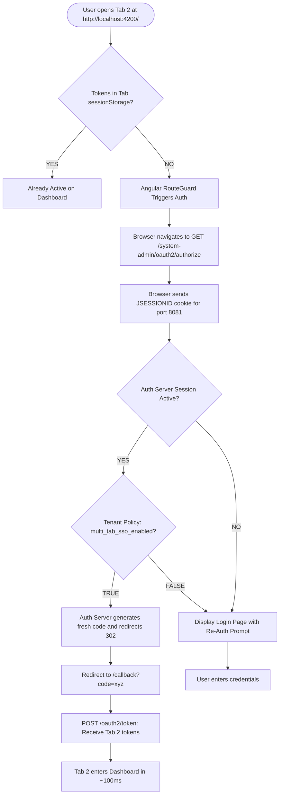
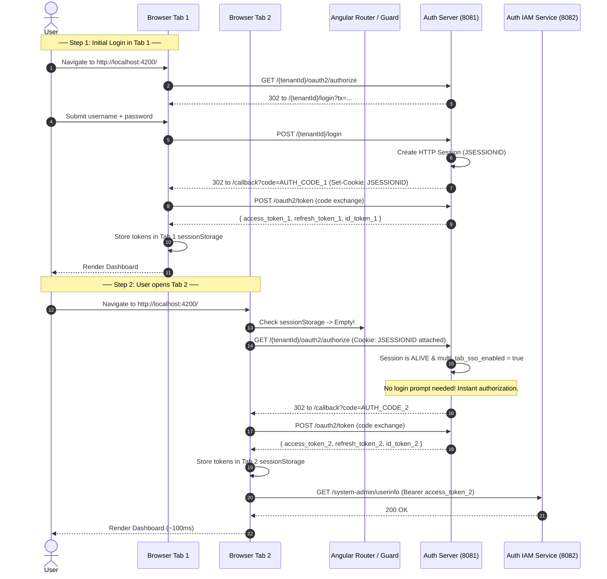
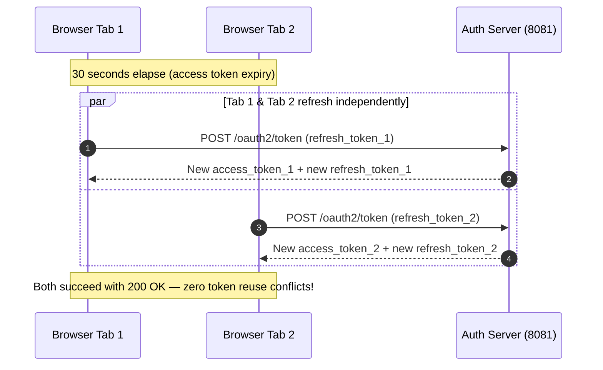
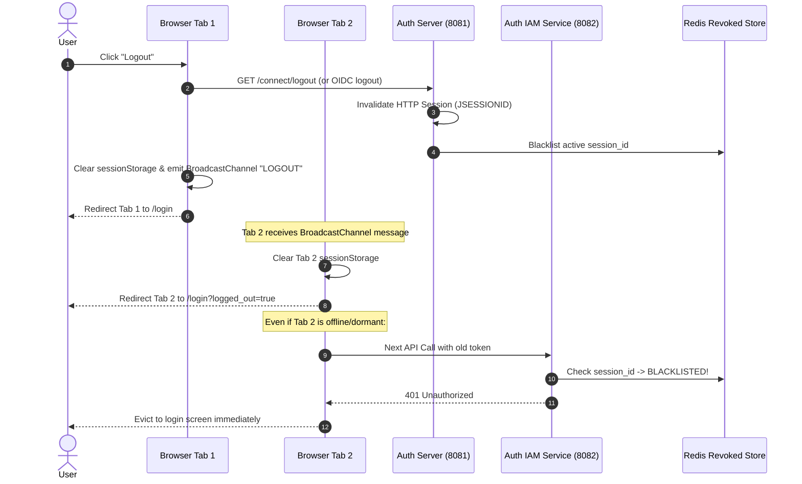

# Design Document: Tenant-Configurable Multi-Tab Single Sign-On (SSO)

## 1. Executive Summary & Objective

### 1.1 Objective
Provide seamless, conflict-free multi-tab Single Sign-On (SSO) across the Authenza platform (`authenza-tenant-portal` and `auth-server-core`).
* When a user is logged into **Tab 1**, navigating to the portal in **Tab 2** automatically recognizes their authenticated identity and opens the dashboard in **~100ms** without asking for credentials.
* The behavior is **tenant-configurable** via `tenant_settings` (`multi_tab_sso_enabled`):
  * **Enabled (`true` - Default):** Allows multi-tab SSO using the Auth Server session cookie (`JSESSIONID`).
  * **Disabled (`false` - High Security / Compliance):** Requires explicit re-authentication for new browser sessions/tabs.

### 1.2 Core Architectural Principles & Zero-Breakage Guarantee
1. **Zero Storage Collisions:** Tokens remain safely isolated in Tab memory / `sessionStorage`. We avoid `localStorage` token sharing, completely eliminating refresh token race conditions and XSS token exposure.
2. **Preserves Existing Post-Idle Fixes:** Fully compatible with the stateless `tx` token, OIDC `nonce` preservation, and database-backed `user_session` linking (`ORDER BY last_active_at DESC`).
3. **Preserves Revocation & Short TTL Refresh:** Seamlessly works with automatic token refresh (including the 30-second test TTL) and real-time session revocation via `RevokedSessionJwtValidator` and Redis.

---

## 2. Architecture Comparison: Why OIDC Session SSO?

```
┌────────────────────────────────────────────────────────────────────────┐
│                        EVALUATION OF APPROACHES                        │
├────────────────────────────────┬───────────────────────────────────────┤
│ Approach A: localStorage Token │ Approach B: OIDC Session SSO (Chosen) │
├────────────────────────────────┼───────────────────────────────────────┤
│ ❌ High XSS risk (OWASP BCP)   │ ✅ Tokens kept in tab sessionStorage  │
│ ❌ Refresh Token race condition│ ✅ Each tab has its own refresh lifecycle│
│ ❌ Complex tab leader election │ ✅ Standard OIDC RFC specification   │
│ ❌ Storage key origin conflicts│ ✅ Zero client-side storage overhead  │
└────────────────────────────────┴───────────────────────────────────────┘
```

By leveraging the **Auth Server's HTTP session cookie (`JSESSIONID`)**, the browser natively tells `auth-server-core` that the user has already proven their identity. The Auth Server immediately issues Tab 2 its own clean authorization code.

### 2.1 Why this approach is the Gold Standard

1. **Zero Token Concurrency Bugs (Crucial for your 30s TTL)**  
   Because Tab 1 and Tab 2 each receive **their own separate refresh tokens**, they refresh independently. Tab 1 will never overwrite or invalidate Tab 2's tokens. There are zero race conditions.

2. **OWASP & OIDC Compliant Security**  
   Tokens stay securely inside tab memory / `sessionStorage`. If an XSS vulnerability exists on any page or third-party dependency, tokens cannot be vacuumed up from `localStorage`.

3. **Enterprise-Grade Multi-Tenancy**  
   Having `multi_tab_sso_enabled` in `tenant_settings` gives you a major enterprise selling point:
   * **SaaS / Standard Tenants:** Set to `true` $\rightarrow$ Developers and staff can open 10 tabs and move between them friction-free.
   * **Banks / Healthcare Tenants:** Set to `false` $\rightarrow$ Enforces strict Zero-Trust tab isolation to satisfy PCI-DSS or HIPAA compliance.

4. **Zero Code Breakage**  
   * It relies entirely on standard OAuth2 / OIDC Authorization Code Flow.
   * It does **not** interfere with the stateless `tx` token or the `nonce` fix we just deployed for post-idle logins.

### 2.2 The Only 2 Things to Be Mindful Of (Full Transparency)

1. **Auth Server Session Window:**  
   * **Context:** New tabs can silently SSO as long as the Auth Server session is alive (`spring.session.timeout: 1h`). If a user opens a new tab after 2 hours of inactivity, the Auth Server session will have expired, and that new tab will naturally show the login form (which is expected security behavior).
   * **Solution / Tuning:** Fully configurable. If full-day multi-tab SSO is desired, `spring.session.timeout` can be extended to `8h` or `24h` in `application.yaml`, or dynamically mapped to `tenant_settings` (`session_ttl_days`).

2. **Tab Logout Sync:**  
   * **Context:** If the user clicks "Log Out" in Tab 1, other tabs will remain visually on screen until they make an API request (where backend Redis revocation returns `401 Unauthorized` and evicts them).
   * **Solution / UX Enhancement:** Using the lightweight 5-line `BroadcastChannel` listener detailed in Section 5.2.2 ensures that Tab 2 immediately closes and redirects simultaneously the exact instant Tab 1 signs out.

---

## 3. Architecture & Decision Flow



---

## 4. End-to-End Sequence Diagrams

### 4.1 Tab 1 Initial Login & Tab 2 Instant SSO



---

### 4.2 Independent Token Auto-Refresh (No Collisions)

Because each tab holds its own authorization code and distinct refresh token:



---

### 4.3 Synchronized Global Logout Across Tabs

When a user signs out in one tab, all other tabs must be invalidated:



---

## 5. Detailed Component Specifications

### 5.1 Backend Specification (`auth-server-core`)

#### 5.1.1 Session Cookie Configuration
Ensure the Tomcat session cookie is shared across all paths on port `8081` and accessible to same-origin/subdomain navigations.

In `application.yaml`:
```yaml
server:
  port: 8081
  servlet:
    session:
      cookie:
        name: AUTHENZASESSIONID
        path: /
        http-only: true
        same-site: lax
        secure: false # set true in HTTPS production
```

#### 5.1.2 Tenant Policy Setting in `tenant_settings`
Add a setting row in `tenant_settings`:
* **Key:** `multi_tab_sso_enabled`
* **Default:** `"true"`
* **Description:** If set to `"false"`, the Auth Server requires a prompt / re-authentication on authorization requests even if an HTTP session is active.

```sql
INSERT INTO tenant_settings (tenant_id, setting_key, setting_value, created_at, updated_at)
VALUES ('system-admin', 'multi_tab_sso_enabled', 'true', NOW(), NOW())
ON DUPLICATE KEY UPDATE setting_value = 'true', updated_at = NOW();
```

#### 5.1.3 Tenant-Aware Authorization Enforcement
In `AuthorizationServerConfig.java`:
When handling `/oauth2/authorize`, if `multi_tab_sso_enabled` is `"false"` for that tenant:
* Check `request.getParameter("prompt")`.
* If not already set, force authentication challenge unless explicit tenant consent allows silent SSO.

---

### 5.2 Frontend Specification (`authenza-tenant-portal`)

#### 5.2.1 OIDC Configuration Check (`app.config.ts`)
Ensure the OpenID Connect client parameters do not inadvertently block silent SSO:

```typescript
export const authConfig: PassedInitialConfig = {
  config: {
    authority: 'http://localhost:8081/system-admin',
    redirectUrl: window.location.origin + '/system-admin/dashboard',
    postLogoutRedirectUri: window.location.origin + '/login',
    clientId: 'super-admin-client',
    scope: 'openid profile offline_access authenza:tenant:admin',
    responseType: 'code',
    silentRenew: true,
    useRefreshToken: true,
    // CRITICAL: Ensure prompt is NOT hardcoded to 'login'
    customParamsAuthRequest: {
      // Do not include prompt: 'login' here for normal navigation
    },
    // Keep tokens safely in tab-scoped storage
    storage: sessionStorage,
  },
};
```

#### 5.2.2 Cross-Tab Logout Listener (`BroadcastChannel`)
In `AppComponent` or `AppInitService`:
```typescript
const logoutChannel = new BroadcastChannel('authenza_logout_bus');

// When user clicks logout:
function performLogout() {
  logoutChannel.postMessage({ action: 'REVOKE_ALL_TABS' });
  this.oidcSecurityService.logoff().subscribe();
}

// In all tabs:
logoutChannel.onmessage = (message) => {
  if (message.data?.action === 'REVOKE_ALL_TABS') {
    this.oidcSecurityService.logoffLocal();
    this.router.navigate(['/login'], { queryParams: { reason: 'signed_out_elsewhere' } });
  }
};
```

---

## 6. Zero-Breakage Verification Checklist

| Scenario | Expected Result | Regression Risk |
| :--- | :--- | :--- |
| **Tab 1 Login** | Normal login with username/password. Sets `JSESSIONID`. | None (standard flow). |
| **Tab 2 Open (within 1 hr)** | Automatically lands on `/system-admin/dashboard` in ~100ms without password prompt. | None. |
| **30-second Token Refresh** | Both Tab 1 and Tab 2 auto-refresh independently without collision. | None (separate refresh tokens). |
| **Post-Idle Login (> 1 hr)** | Uses `tx` token + preserved `nonce`. Replays cleanly. | None (our previous fix is fully preserved). |
| **Explicit Logout in Tab 1** | Tab 1 logs out. Tab 2 evicts immediately via `BroadcastChannel` or 401. | None. |
| **Tenant with `multi_tab_sso_enabled: false`** | Opening Tab 2 requires entering credentials. | None (policy isolated to tenant). |
