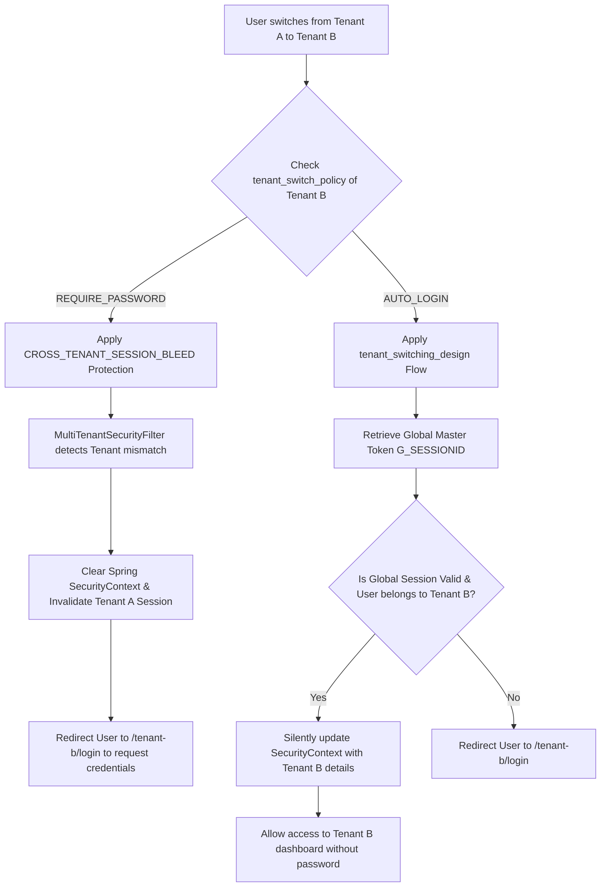

# Consolidated Tenant Switching Security Policy Design

This document details the unified security and switching model for the Authenza B2B multitenant platform. It consolidates the concepts of **Cross-Tenant Session Bleed Prevention** and **Flexible Tenant Switch Policies**.

---

## 1. Core Architectural Principle

To secure our path-based multitenancy (e.g., `/{tenantId}/`), the platform must prevent session leakage while remaining flexible for diverse enterprise configurations. 

Each tenant's administrator (`tenant:admin`) can toggle the switching behavior using a new setting:
* **Key:** `tenant_switch_policy`
* **Default Value:** `REQUIRE_PASSWORD` (Secure by Default)

---

## 2. Dual Execution Modes

Based on the value of `tenant_switch_policy`, the backend executes one of two paths:

---

## 3. Detailed Component Architecture

### Path 1: `REQUIRE_PASSWORD` (Zero Session Bleed)
* **Goal:** Absolute security boundaries. Prevents any domain-scoped session cookies from automatically authenticating a user in another tenant's domain.
* **Mechanism:**
  * The `MultiTenantSecurityFilter` checks if the current `Authentication` principal's `tenantId` matches the path's `{tenantId}`.
  * If it mismatch, the filter clears the `SecurityContextHolder` immediately and sends the user to the login screen.

### Path 2: `AUTO_LOGIN` (Silent SSO)
* **Goal:** High convenience for trusted contractors, consultants, and global admins.
* **Mechanism:**
  * When logging in, a secure HTTP-Only root cookie (`G_SESSIONID`) is established in the browser.
  * When switching, `auth-server-core` checks `auth-master-service` to confirm the global account possesses a valid master session and is registered in the target tenant database.
  * If verification succeeds, a fresh security session is silently minted for Tenant B.

---

## 4. Why `REQUIRE_PASSWORD` is the Default

* **Secure by Default:** Adhering to Zero Trust principles, the platform defaults to the most secure configuration.
* **Compliance Audit Ready:** Ensures B2B tenants satisfy ISO 27001/SOC2 boundary rules by default, requiring users to explicitly input their password/passkey when accessing a different organization's tenant workspace.
