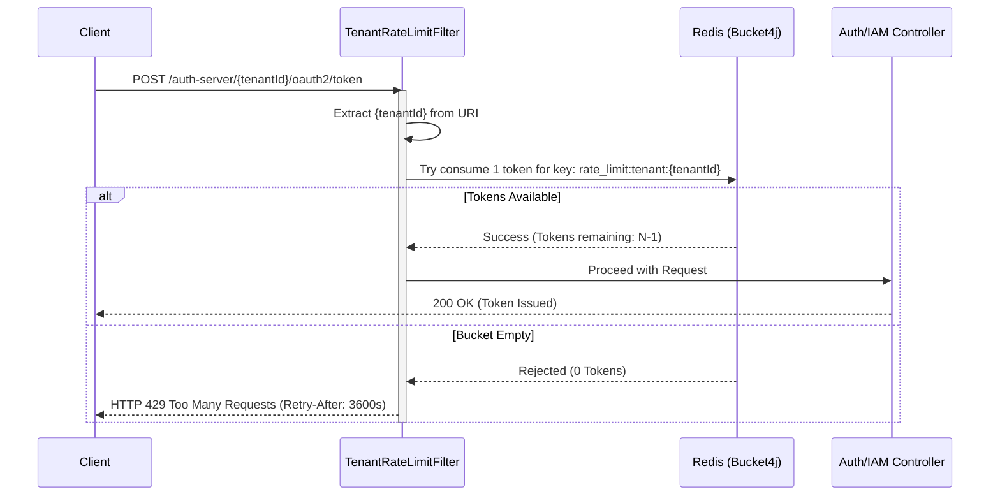

# Tenant-Level Rate Limiting Architecture Plan

## 1. Objective
To protect the Authenza infrastructure from "noisy neighbor" DDoS attacks by throttling API and authentication requests on a per-tenant basis. If one tenant is under a credential stuffing attack or has a misconfigured script hitting the auth server, it must be isolated and rate-limited without degrading the performance of other tenants on the same cluster.

## 2. The "Noisy Neighbor" Problem
In a multi-tenant SaaS application, all tenants share the same underlying compute resources (CPU, Memory, Database connections). If Tenant A receives a massive spike in traffic (e.g., 50,000 requests per second), it can exhaust the connection pool, causing Tenant B and Tenant C to experience timeouts and downtime.

## 3. Proposed Solution: Distributed Token Bucket (Bucket4j + Redis)
To enforce limits accurately across multiple application pods (horizontal scaling), we cannot use in-memory counters. We will use the **Token Bucket** algorithm backed by **Redis**. 

The Java library **Bucket4j** is the industry standard for this and integrates perfectly with Spring Data Redis.

### Rate Limiting Tiers (Dual-Layer)
We enforce two separate rate limits simultaneously to stop both sudden spikes and sustained attacks. These are configured in `application.yaml`:

```yaml
app:
  security:
    rate-limit:
      burst-per-minute: 200     # Stops immediate script DDoS / brute force
      sustained-per-hour: 5000  # Stops slow-and-steady scraping
```

## 4. Architecture Flow



## 5. Implementation Steps

### Step 1: Add Dependencies
Add `bucket4j-core` and `bucket4j-redis` to `auth-server-core` and `auth-iam-service`.

### Step 2: Configure Redis Proxy Manager
Create a `RateLimitConfig.java` class that configures a `RedisProxyManager`. This object manages the state of all token buckets directly in your existing Redis instance.

### Step 3: Create the Rate Limiting Filter
Create a `TenantRateLimitFilter` that extends `OncePerRequestFilter`.
*   It intercepts all incoming requests.
*   It resolves the `tenantId` using `TenantContextHolder`.
*   It injects the `burst-per-minute` and `sustained-per-hour` limits from `application.yaml`.
*   It configures a dual-layer `BucketConfiguration`.
*   It calls `bucket.tryConsume(1)`.
*   If `false`, it immediately halts the request and returns a `429 Too Many Requests` response.

### Step 4: Add HTTP Rate-Limit Transparency Headers
For API transparency, the filter injects standard rate-limit headers into the HTTP response. These headers are critical for third-party developers and client applications to intelligently throttle their own traffic and prevent being blocked.

The following headers are injected:

1.  **`X-RateLimit-Limit` (Added to all requests):**
    *   *Purpose:* Informs the client of their absolute maximum burst capacity.
    *   *Use Case:* Helps developers quickly understand their current API tier limits (e.g., 200 req/min) without needing to check documentation or admin dashboards.

2.  **`X-RateLimit-Remaining` (Added to all requests):**
    *   *Purpose:* Indicates how many tokens (requests) the client currently has left in their bucket.
    *   *Use Case:* Client applications can monitor this number on every successful response. If it drops dangerously low (e.g., < 5), the client can programmatically slow down its outgoing requests to avoid ever hitting a 429 error.

3.  **`X-RateLimit-Retry-After` (Added ONLY on HTTP 429 failures):**
    *   *Purpose:* Tells the client exactly how many *seconds* they must wait before the server will accept another request.
    *   *Use Case:* When a script or frontend SPA receives a 429 error, it can read this header, pause its execution thread (`await sleep(retryAfter * 1000)`), and automatically retry the request safely once the penalty period ends.

4.  **`X-RateLimit-Reset` (Added ONLY on HTTP 429 failures):**
    *   *Purpose:* Provides the exact UNIX epoch timestamp (in milliseconds) when the rate limit bucket will have enough tokens to proceed.
    *   *Use Case:* Useful for backend synchronization. If a tenant application has a background job queue pulling from Authenza, it can pause the entire queue until the `Reset` timestamp is reached, ensuring it doesn't waste CPU cycles firing requests that are guaranteed to be blocked.

## 6. Why Bucket4j + Redis?
1.  **Cluster-Safe:** Uses Redis Lua scripts to ensure atomicity. Two pods handling requests at the exact same millisecond won't cause race conditions.
2.  **Zero-Locking:** Extremely fast. It adds less than 1ms of latency to each request.
3.  **Graceful Degradation:** If Redis goes down completely, the filter can be configured to fail-open (allow traffic) so an infrastructure blip doesn't take down the whole auth system.
