# Implementation Plan: Tenant Switching Policy & Isolation Hardening

This plan outlines the steps required to complete the tenant switching and isolation capabilities specified in [consolidated_tenant_switching.md](file:///Users/shashankjain/Downloads/authenza-auth-server/consolidated_tenant_switching.md) and [ROADMAP.md](file:///Users/shashankjain/Downloads/authenza-auth-server/ROADMAP.md), addressing:
1. **`tenants.active` Status Check** — Blocking access to suspended/inactive tenants.
2. **`REQUIRE_PASSWORD` Backend Enforcement** — Preventing Cross-Tenant Session Bleed.
3. **Tenant Switch Policy REST API** — Allowing programmatic configuration.
4. **Admin Portal UI Toggle** — Providing a self-service setting in the Tenant Admin Portal.

---

## 1. Codebase Audit & Gap Analysis

A critical check of active code reveals that while [ROADMAP.md](file:///Users/shashankjain/Downloads/authenza-auth-server/ROADMAP.md) marked Step 1 as completed, several core security components were only specified in design documents and are **not yet implemented in code**:

| Item | Specification in Design Docs | Current State in Codebase | Action Required |
| :--- | :--- | :--- | :--- |
| **`tenants.active` check** | `MultiTenantSecurityFilter` checks if tenant is active before routing. | `TenantLoaderService` loads all tenants without filtering by `active`. `MultiTenantSecurityFilter` only checks `isKnownTenant()`. | **Build active status tracking & rejection.** |
| **`TenantUserDetails`** | Custom `UserDetails` carrying `tenantId` in the security session. | Does not exist. `JdbcTenantUserDetailsService` builds Spring's standard `User` object. | **Create `TenantUserDetails` & integrate.** |
| **Session Bleed Prevention** | `MultiTenantSecurityFilter` detects tenant mismatch and purges session on `REQUIRE_PASSWORD`. | Filter sets `TenantContextHolder` and issuer context, but never inspects existing `SecurityContext` or `tenant_switch_policy`. | **Implement mismatch detection & session invalidation.** |
| **Switch Policy REST API** | Admin can view and update `tenant_switch_policy`. | Key exists in Liquibase V0.0.11 `tenant_settings`, but no dedicated typed endpoint exists in `TenantSettingsController`. | **Add typed endpoints in `auth-iam-service`.** |
| **Admin Portal UI Toggle** | Dropdown in Security Policies panel. | Not implemented in portal frontend. | **Define Angular UI component & contract.** |

---

## 2. Architecture & Request Flow

```mermaid
sequenceDiagram
    autonumber
    actor User as Browser / User
    participant Filter as MultiTenantSecurityFilter
    participant RoutingDS as TenantRoutingDataSource
    participant Cache as TenantSettingsCache
    participant App as Spring Security / Controllers

    User->>Filter: Request to /{tenantId}/* (Cookie: JSESSIONID)
    
    rect rgb(30, 30, 45)
    Note over Filter,RoutingDS: Phase A: Tenant Existence & Status Check
    Filter->>RoutingDS: isKnownTenant(tenantId)
    alt Tenant Not Found
        Filter-->>User: 302 Redirect /error/invalid-tenant
    end
    Filter->>RoutingDS: isTenantActive(tenantId)
    alt Tenant Suspended / Inactive
        Filter-->>User: 302 Redirect /error/tenant-suspended
    end
    end

    rect rgb(45, 30, 40)
    Note over Filter,Cache: Phase B: Cross-Tenant Session Mismatch Check
    alt User is Authenticated in Session
        Filter->>Filter: Compare session.tenantId vs path.tenantId
        opt Tenant Mismatch (e.g. Session is Tenant A, Path is Tenant B)
            Filter->>Cache: getSetting(tenantB, "tenant_switch_policy")
            alt Policy == REQUIRE_PASSWORD (Default)
                Filter->>Filter: SecurityContextHolder.clearContext()
                Filter->>Filter: session.invalidate()
                Filter-->>User: 302 Redirect /{tenantB}/login
            else Policy == AUTO_LOGIN
                Note over Filter: Phase 9 Hook: Validate G_SESSIONID & silent mint
            end
        end
    end
    end

    Filter->>App: Proceed down FilterChain (Authorized)
```



---

## 3. Detailed Implementation Steps

### Phase 1: Tenant Active Status Check (`tenants.active`)

#### 1.1 Update `TenantConfig` and `TenantRoutingDataSource`
* **File:** [`TenantConfig.java`](file:///Users/shashankjain/Downloads/authenza-auth-server/auth-common/src/main/java/com/authenza/common/TenantConfig.java)
  * Add `active` field to record:
    ```java
    public record TenantConfig(
        String tenantId,
        String jdbcUrl,
        String username,
        String password,
        String driverClassName,
        String active
    ) {}
    ```
* **File:** [`TenantRoutingDataSource.java`](file:///Users/shashankjain/Downloads/authenza-auth-server/auth-tenant-adapter/src/main/java/com/authenza/adapter/routing/TenantRoutingDataSource.java)
  * Add thread-safe status map: `ConcurrentHashMap<String, String> tenantStatuses`.
  * Add method `public boolean isTenantActive(String tenantId)`:
    * Returns `true` if status is `"ACTIVE"` (case-insensitive) or `"true"`.
  * Add method `public void setTenantStatus(String tenantId, String status)`.

#### 1.2 Update `TenantLoaderService`
* **File:** [`TenantLoaderService.java`](file:///Users/shashankjain/Downloads/authenza-auth-server/auth-tenant-adapter/src/main/java/com/authenza/adapter/config/TenantLoaderService.java)
  * Update SQL query:
    ```sql
    SELECT tenant_id, jdbc_url, username, encrypted_password, driver_class_name, active FROM tenants
    ```
  * Pass `active` into `TenantRoutingDataSource.setTenantStatus()`.

#### 1.3 Update `MultiTenantSecurityFilter` & `LoginController`
* **File:** [`MultiTenantSecurityFilter.java`](file:///Users/shashankjain/Downloads/authenza-auth-server/auth-server-core/src/main/java/com/authenza/core/security/MultiTenantSecurityFilter.java)
  * After verifying `routingDataSource.isKnownTenant(tenantId)`, verify `routingDataSource.isTenantActive(tenantId)`.
  * If inactive, redirect to `/error/tenant-suspended?tenantId={tenantId}`.
* **File:** [`LoginController.java`](file:///Users/shashankjain/Downloads/authenza-auth-server/auth-server-core/src/main/java/com/authenza/core/web/LoginController.java)
  * Add endpoint `@GetMapping("/error/tenant-suspended")` rendering `error-page.html` with title `"Tenant Suspended"` and code `"TENANT_SUSPENDED"`.

---

### Phase 2: Cross-Tenant Session Isolation & `REQUIRE_PASSWORD`

#### 2.1 Create `TenantUserDetails`
* **File:** `auth-server-core/src/main/java/com/authenza/core/security/TenantUserDetails.java`
  * Implements `UserDetails` and `CredentialsContainer`.
  * Stores:
    * `tenantId` (immutable String)
    * `username`
    * `password`
    * `authorities`
    * `enabled`, `accountNonExpired`, `credentialsNonExpired`, `accountNonLocked`
  * Provides getter: `public String getTenantId()`.

#### 2.2 Update `JdbcTenantUserDetailsService`
* **File:** [`JdbcTenantUserDetailsService.java`](file:///Users/shashankjain/Downloads/authenza-auth-server/auth-server-core/src/main/java/com/authenza/core/security/JdbcTenantUserDetailsService.java)
  * Update `loadFromCentralizedAccount` (line 204) to construct and return `TenantUserDetails` with `tenantId`.
  * Update `loadFromLocalAccount` (line 280) to construct and return `TenantUserDetails` with `tenantId`.

#### 2.3 Update `MultiTenantSecurityFilter` with Session Check
* **File:** [`MultiTenantSecurityFilter.java`](file:///Users/shashankjain/Downloads/authenza-auth-server/auth-server-core/src/main/java/com/authenza/core/security/MultiTenantSecurityFilter.java)
  * Inject `TenantSettingsCache`.
  * Add cross-tenant mismatch detection:
    ```java
    Authentication auth = SecurityContextHolder.getContext().getAuthentication();
    if (auth != null && auth.isAuthenticated() && !(auth instanceof AnonymousAuthenticationToken)) {
        if (auth.getPrincipal() instanceof TenantUserDetails tenantUser) {
            String authenticatedTenant = tenantUser.getTenantId();
            if (authenticatedTenant != null && !authenticatedTenant.equals(tenantId)) {
                String policy = settingsCache.getSetting(tenantId, "tenant_switch_policy");
                if (policy == null || "REQUIRE_PASSWORD".equalsIgnoreCase(policy)) {
                    log.warn("[CROSS-TENANT] Prevented session bleed: user '{}' from '{}' attempted access to '{}'",
                            tenantUser.getUsername(), authenticatedTenant, tenantId);
                    
                    SecurityContextHolder.clearContext();
                    HttpSession session = request.getSession(false);
                    if (session != null) {
                        session.invalidate();
                    }
                    response.sendRedirect("/" + tenantId + "/login");
                    return;
                } else if ("AUTO_LOGIN".equalsIgnoreCase(policy)) {
                    // Extension point: Phase 9 Silent SSO with G_SESSIONID
                    log.debug("[TENANT-SWITCH] AUTO_LOGIN policy configured for tenant '{}'", tenantId);
                }
            }
        }
    }
    ```

---

### Phase 3: Tenant Switch Policy REST API (`auth-iam-service`)

#### 3.1 Service Layer Updates
* **File:** [`TenantSettingsService.java`](file:///Users/shashankjain/Downloads/authenza-auth-server/auth-iam-service/src/main/java/com/authenza/iam/service/TenantSettingsService.java)
  * Add constants:
    ```java
    public static final String TENANT_SWITCH_POLICY = "tenant_switch_policy";
    public static final String POLICY_REQUIRE_PASSWORD = "REQUIRE_PASSWORD";
    public static final String POLICY_AUTO_LOGIN = "AUTO_LOGIN";
    ```
  * Add helper methods:
    * `public String getTenantSwitchPolicy()` (defaults to `REQUIRE_PASSWORD` if unset)
    * `public void setTenantSwitchPolicy(String policy)` (validates that policy is either `REQUIRE_PASSWORD` or `AUTO_LOGIN`, updates DB, and broadcasts cache invalidation).

#### 3.2 Controller Layer Updates
* **File:** [`TenantSettingsController.java`](file:///Users/shashankjain/Downloads/authenza-auth-server/auth-iam-service/src/main/java/com/authenza/iam/controller/TenantSettingsController.java)
  * Add endpoint `GET /api/v1/settings/switch-policy`:
    ```json
    {
      "status": 200,
      "success": true,
      "data": { "policy": "REQUIRE_PASSWORD" }
    }
    ```
  * Add endpoint `PUT /api/v1/settings/switch-policy`:
    ```json
    { "policy": "REQUIRE_PASSWORD" }
    ```

---

### Phase 4: Admin Portal UI Toggle (`authenza-tenant-portal`)

#### 4.1 UI Location & Component Structure
* **Location:** Security Policies Settings View (`authenza-tenant-portal/src/app/pages/security-policies/`)
* **Component:** `TenantSwitchPolicyCardComponent`
* **Fields:**
  * **Title:** Workspace & Tenant Switching Policy
  * **Description:** Controls authentication requirements when an authorized user switches into this workspace from another tenant.
  * **Dropdown Options:**
    1. `REQUIRE_PASSWORD` — **Require Credentials (Zero Trust / Recommended)**  
       *Helper text:* Forces users to explicitly verify credentials when hopping across workspaces. Eliminates cross-tenant session bleed.
    2. `AUTO_LOGIN` — **Silent SSO (Phase 9 Preview)**  
       *Helper text:* Allows seamless switching for users with verified global account memberships.
  * **Save Action:** Calls `PUT /api/v1/settings/switch-policy` with immediate toast feedback.

---

## 4. Verification & Testing Matrix

| Scenario | Test Setup | Expected Outcome |
| :--- | :--- | :--- |
| **Suspended Tenant Block** | Set `tenants.active = 'SUSPENDED'` for Tenant X. Navigate to `/tenant-x/login`. | Request intercepted by `MultiTenantSecurityFilter` → redirected to `/error/tenant-suspended`. |
| **Normal Tenant Access** | Set `tenants.active = 'ACTIVE'` for Tenant A. Navigate to `/tenant-a/login`. | Login page renders normally. |
| **Intra-Tenant Navigation** | User logs into Tenant A (`/tenant-a/login`). Navigates to `/tenant-a/oauth2/authorize`. | Session preserved. Authorized without re-prompt. |
| **Cross-Tenant Hopping (`REQUIRE_PASSWORD`)** | User logs into Tenant A. Changes browser URL to `/tenant-b/oauth2/authorize`. | Filter detects session mismatch (`tenantA != tenantB`). Session cleared → redirected to `/tenant-b/login`. |
| **Policy API Read/Write** | `PUT /api/v1/settings/switch-policy` with body `{"policy": "REQUIRE_PASSWORD"}`. | Returns 200 OK. Caffeine local cache invalidated. |
| **Invalid Policy Rejected** | `PUT /api/v1/settings/switch-policy` with body `{"policy": "INVALID_VAL"}`. | Returns 400 Bad Request. |
