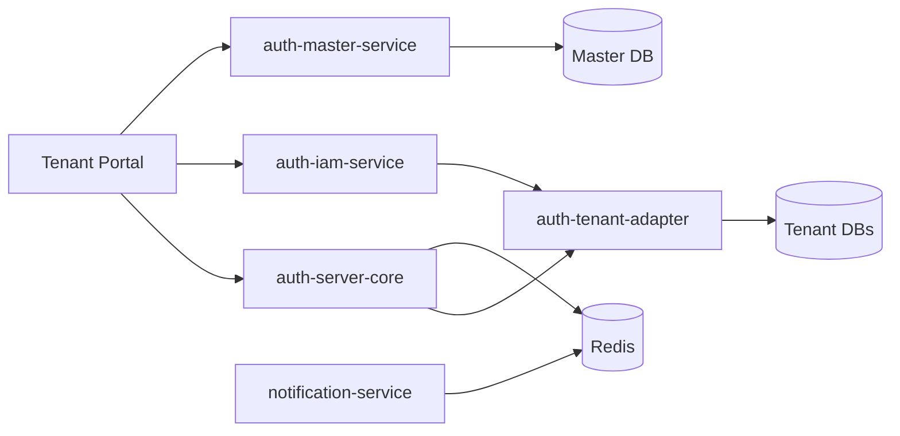

# Chapter 2 — Architecture at a glance

| | |
|--|--|
| Part | [I — Foundations](README.md) |
| Previous | [← What is Authenza?](01-what-is-authenza.md) |
| Next | [Module map →](03-module-map.md) |

---

## Idea

Requests carry a **tenant**. The adapter routes JDBC to that tenant’s database. Login and tokens are issued by **auth-server-core**; user/admin APIs live in **auth-iam-service**. Master only provisions and registers tenants.

## Typical local ports

| Service | Port |
|---------|------|
| Master | `8080` |
| Auth server (OIDC / login) | `8081` |
| IAM | `8082` |
| Notification | `8083` |
| Portal | `4200` |

## Mental model for debugging

| Symptom | Look first |
|---------|------------|
| Wrong tenant’s data | Tenant routing / `TenantContextHolder` / URI `tenantId` |
| Login UI / token issues | `auth-server-core` |
| Users / settings / sessions API | `auth-iam-service` |
| Emails not sent | Redis channel + `auth-notification-service` |
| New tenant missing schema | Master provisioning + Liquibase (`auth-tenant-schema`) |

## Further reading

- Full diagram: [`docs/ARCHITECTURE.md`](../../docs/ARCHITECTURE.md) §2  

---

← [Ch 1](01-what-is-authenza.md) · [Chapter 3 — Module map →](03-module-map.md)
